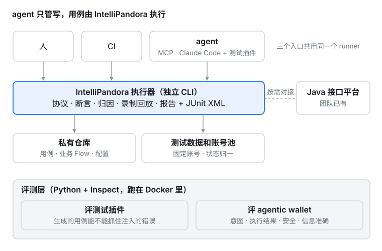
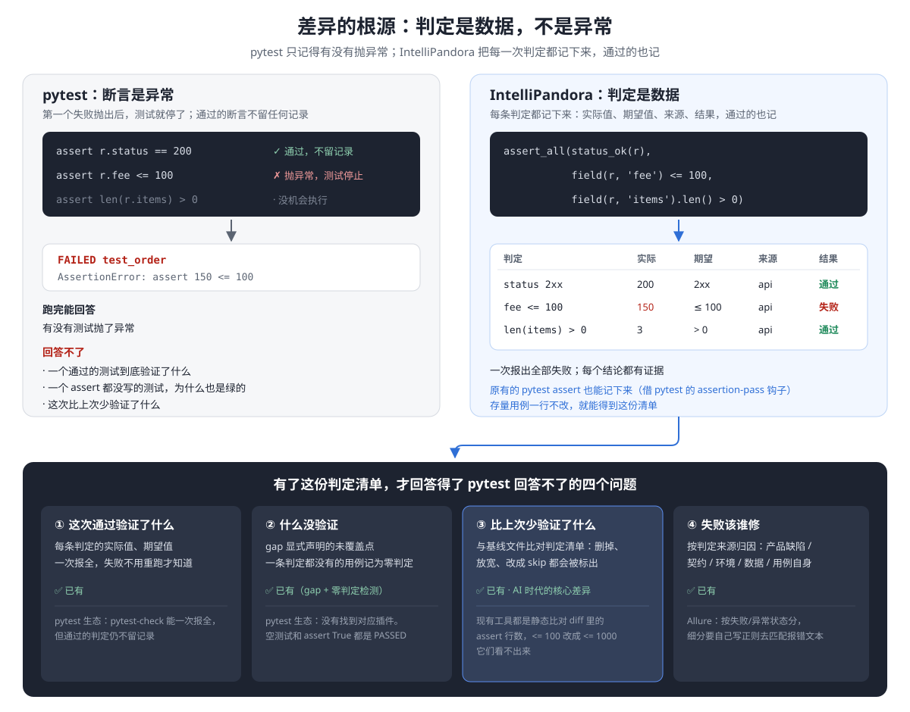
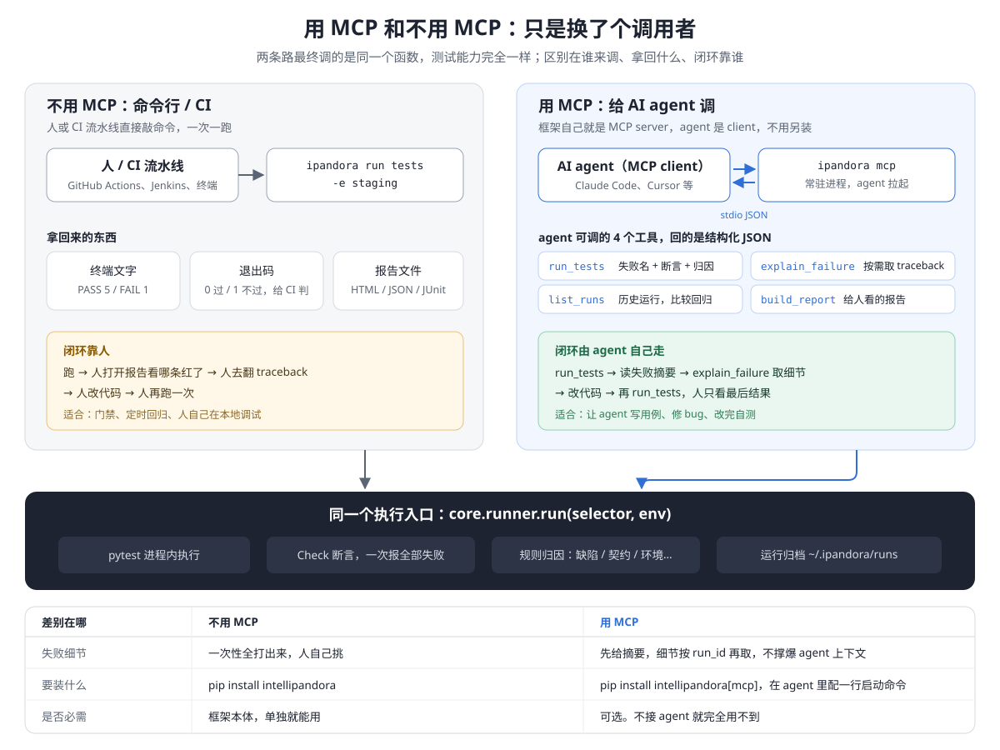
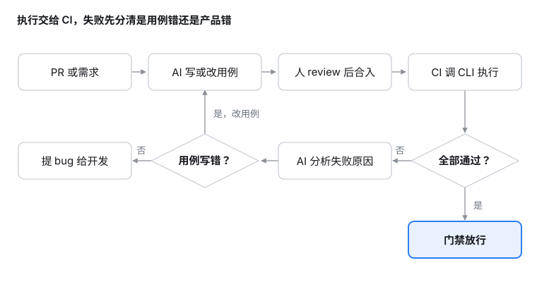

# IntelliPandora

[](https://github.com/Conan-Shao/IntelliPandora/actions/workflows/ci.yml) [](docs/security/report.md)

> AI 时代的测试**判定层**，建在 pytest 之上：**agent 写，框架判，人审。**
>
> pytest 回答「有没有测试失败」；IntelliPandora 回答「这次通过可不可信」：验证了什么、没验证什么、比上次少验证了什么、失败该谁修。
>
> 目前支持 HTTP 接口测试和 Web 自动化（Playwright）；App 自动化在规划中。框架不绑定任何业务，业务相关的用例、流程、环境配置放在使用方自己的仓库里。

agent 同一轮里既写代码又写测试，绿灯就可以被「做」出来。框架需要做的不只是执行测试，而是**为测试结果提供可信的依据**：判定确定、可复现、不调 LLM，而且判定本身的变化要能被看见。人、CI、agent 三个入口调用同一套 runner，跑出来的结果一致。



## 为什么不直接用 pytest

**pytest 回答「有没有测试失败」，IntelliPandora 回答「这次通过可不可信」。** 用例照样是 pytest 用例，现有套件不用改就能跑。



pytest 的断言是异常：通过时什么都不留下。所以它回答不了：一个通过的测试验证了什么？一个 assert 都没写的测试为什么也是绿的？这次比上次少验证了什么？

AI 写测试之后，最后这个问题变成了关键：允许修改测试时，agent 走捷径的做法 96% 是改测试本身（[HackTrace](https://arxiv.org/html/2610.03055v1)）。我们的分工是 **agent 写，框架判，人审**：框架给出两个结论，一是结果，二是判定强度有没有变弱；人只审被标出来的几条。

另一条腿是**开箱的全栈方案**：HTTP 今天可用，Web / App 按"集成，不封装"接入，驱动 API 原样暴露，框架只补配置、证据、判定和归因。

📖 [定位：为什么不直接用 pytest](docs/guide/why.md)：哪些能力 pytest 生态已经有、哪些是独有的、为什么这样设计 · [路线](docs/design/decisions/12-定位与路线.md)（含并发）· [前瞻：agent 验证](docs/design/decisions/13-agent验证.md)

## 它解决什么

| | 之前 | 现在 |
|---|---|---|
| 状态码 | 500 静默通过——`status_code` 只用来给日志上色 | 断言层判定，不看就是 `gap` |
| 断言失败 | 第一个失败就停 | `Check` 是值不是异常，`assert_all` 一次报全部 |
| 失败原因 | 自己翻日志 | 归因到 defect / contract / environment / data / harness |
| 跑完的结果 | 控制台一段文字 | HTML + JSON + **JUnit XML**，可直接进 CI 门禁 |
| 超时 | 默认无，一个挂起的接口挂死整个套件 | 连接 10s / 读取 30s，每个请求都有界 |
| TLS | 强制 `verify=False` | 默认开启 |
| 并行执行 | `pytest -n 4` 快了，但每条用例都成了零判定 | `--workers 4`：判定、报告、基线比对与串行逐字节一致；`@pytest.mark.resource` 防止共用账号的用例撞车 |
| Web 自动化 | 只用 `expect` 写的 Playwright 用例在判定上是空的；选择器找不到元素时，分不清是用例过时还是按钮真没了 | `expect` 计入判定清单；失败自动附截图和 trace；按元素的角色和名称复查页面，区分"选择器过时"和"待确认：可能是产品缺陷" |
| 图像判定 | Python 版 Playwright 没有截图比对；自己写的比对，在抗锯齿差异上会误报，换掉基准图也没人发现 | `that(screenshot).matches_golden('checkout')`：只有成块的差异才算数，报告里并排展示基准图、实际截图和差异图，基准图被换掉会被门禁拦下 |
| 并发场景 | 自己开线程：新线程没有登录态，请求也不进报告 | `concurrently()`：同时起跑、带登录态、每个请求都在证据里，还会判断并发是否真的发生了 |

## 安装

```shell
pip install intellipandora            # 内核，依赖只有 8 个
pip install intellipandora[ai]        # 可选：失败归因接 LLM
pip install intellipandora[mcp]       # 可选：agent 入口
pip install intellipandora[system]    # 可选：系统信息工具（psutil）
pip install intellipandora[parallel]  # 可选：并行执行 --workers、单条用例超时 --timeout
pip install intellipandora[web]       # 可选：Web 自动化（Playwright），之后 python -m playwright install chromium
pip install intellipandora[visual]    # 可选：图像判定 matches_golden()
```

从零开始一个用例项目（配置、能离线跑通的示例、给 agent 的 AGENTS.md、带门禁的 CI 样例）：

```shell
ipandora init my-tests && cd my-tests && ipandora run tests
```

📖 [快速开始](docs/guide/quickstart.md)

## 用起来

```shell
ipandora run test/api                        # 跑完出 HTML + JSON + JUnit XML
ipandora run test/api --junit-xml out.xml    # 给 CI 的那份放到指定位置
ipandora run test/api --exclude-flaky        # 门禁模式：已知不稳定的用例不参与判定
ipandora run test/api -e staging             # 叠加 ./conf/staging.yaml，只作用于本次运行
ipandora run test/api --update-baseline      # 接受这次的判定为基线（conf/judgements.json，提交进仓库）
ipandora run test/api --fail-on-weakened     # 门禁：判定比基线弱（删除、放宽、改期望值、改成跳过、零判定）就失败
ipandora mcp                                 # 以 MCP server 方式供 agent 调用
```

写一条用例：

```python
from ipandora.core import api
from ipandora.core.assertion import assert_all, field, status_ok

class OrderService:
    @api.http.post(path="api/order/create")
    def create(self, amount):
        return dict(json={"amount": amount})

def test_create_order():
    """下单成功，金额与请求一致，每个明细价格为正"""
    r = OrderService().create(100)
    assert_all(                                   # 一次报出全部失败，而不是第一个就停
        status_ok(r),
        field(r, 'data.amount') == 100,
        field(r, 'data.status').is_in(['created', 'paid']),
        field(r, 'data.items').each('price').decimal() > 0,
    )
```

失败时：`data.items[*].price > 0 — 1 of 3 items failed: data.items[1].price = Decimal('-1') (expected > 0)`。

📖 [使用手册](docs/guide/README.md)

## 用不用 MCP



两条路调的是同一个 `run()`，测试能力完全一样。MCP 是可选的，只有接 AI agent 时才需要。

## 日常工作流



失败之后第一件事是**分清是用例错还是产品错**——这两件事是不同的人该去修的。归因层做的就是这个判定，`blames_system_under_test` 为假时，报告不会把它算成产品缺陷。

## LLM 的成本边界

**LLM 只出现在「编写时」和「运行后」，绝不出现在「运行时」。**

| 时机 | 是否用 LLM | 成本随什么增长 |
|---|---|---|
| 运行时（执行用例） | ❌ 绝不 | **恒为 0** |
| 编写时（起草用例） | ✅ 外部 agent 写文件 | 人 × 编写次数 |
| 运行后（失败归因、报告摘要） | ⚠️ 可选，默认关 | 失败数，可设上限 |

一天跑 10000 次用例，LLM 调用 0 次。这不是约定，是四条结构性保证：默认安装不含任何 LLM SDK；`ai.enabled: false`；`core/` 不得 import `ai/`（CI 用 AST 检查）；**`rm -rf src/ipandora/ai && pytest` 必须全绿**（CI 里真的在跑）。

📖 [`docs/design/decisions/03-LLM接入边界.md`](docs/design/decisions/03-LLM接入边界.md)

## 代码结构

代码在 `src/ipandora/`：

| | |
|---|---|
| `core/protocol` | 协议层。传输策略、响应解析 |
| `core/assertion` | 断言层。`Check` / `assert_all` / `require` / `gap` |
| `core/runner` | 库可调用的执行入口，CLI 和 MCP 都是它的薄壳；判定清单与基线比对（`inventory.py`） |
| `core/report` | ReportData → HTML / JSON / JUnit XML + 历史归档 |
| `core/triage` | 失败归因（规则优先，LLM 可选） |
| `core/evidence` | 请求响应证据采集 |
| `core/mcp` | agent 入口 |
| `ai/` | 可选 LLM 支持，可整包删除 |

## 文档

| 给谁 | 在哪 |
|---|---|
| 使用者，按任务组织 | [`docs/guide/`](docs/guide/README.md)：快速开始、判定与基线、HTTP、并行与并发、Web、图像、配置、报告、CI、agent |
| 查参数和配置项 | [`docs/reference/`](docs/reference/cli.md)：从代码生成，CI 检查它和代码一致 |
| 想知道它怎么工作 | [`docs/design/architecture.md`](docs/design/architecture.md)：当前架构，随代码更新 |
| 想知道为什么这样设计 | [`docs/design/decisions/`](docs/design/decisions/README.md)：决策与返工记录 |
| agent | [`llms.txt`](llms.txt) 是文档索引；在本仓库开发框架读 [`AGENTS.md`](AGENTS.md)；在用例项目里写用例读 `ipandora init` 生成的 AGENTS.md |

## 开发

```shell
make install && make install-tools   # 锁定版本、校验哈希，与 CI 一致
pytest                               # 全部密闭，零网络依赖
python scripts/smoke_import.py       # 每个模块都 import 得进来
python scripts/check_layering.py     # core/ 不得依赖 ai/
python scripts/check_secrets.py $(git ls-files)
python scripts/check_packaging.py    # 必需数据文件要真的进 wheel
python scripts/mutation.py core/report/junit.py   # 变异测试：故意改坏，看测试抓不抓得住
make security                        # 依赖漏洞、代码扫描、许可证、组件登记
```

📖 [开发手册](docs/dev/IntelliPandora_Dev.md)

## 安全

测试框架会进 CI、拿着测试账号和密钥在被测环境里执行代码，是投毒的高价值目标。所以框架引入的每一个第三方组件都先过准入，进来之后持续扫描：

- **准入**：必要性、许可证、维护状态、发布满 14 天才采用。全部组件登记在 [组件登记表](docs/security/components.md)，代码里声明的依赖和登记表不一致，CI 不让合入。
- **锁定**：CI 和开发环境从带哈希的锁文件安装，装的就是审查过的那一批文件；CI 动作固定到提交 SHA。
- **扫描**：每个 PR、每次合入、每天定时，扫依赖漏洞（pip-audit）、自身代码（bandit）、许可证。结果公开在 **[安全报告](docs/security/report.md)**。
- **发布**：只从 GitHub Actions 通过 PyPI Trusted Publishing 发布，附来源证明；每个版本附 CycloneDX SBOM。

规则与理由见 [`docs/design/decisions/15`](docs/design/decisions/15-第三方组件安全准入与漏洞扫描.md)。

## License

Apache License 2.0
