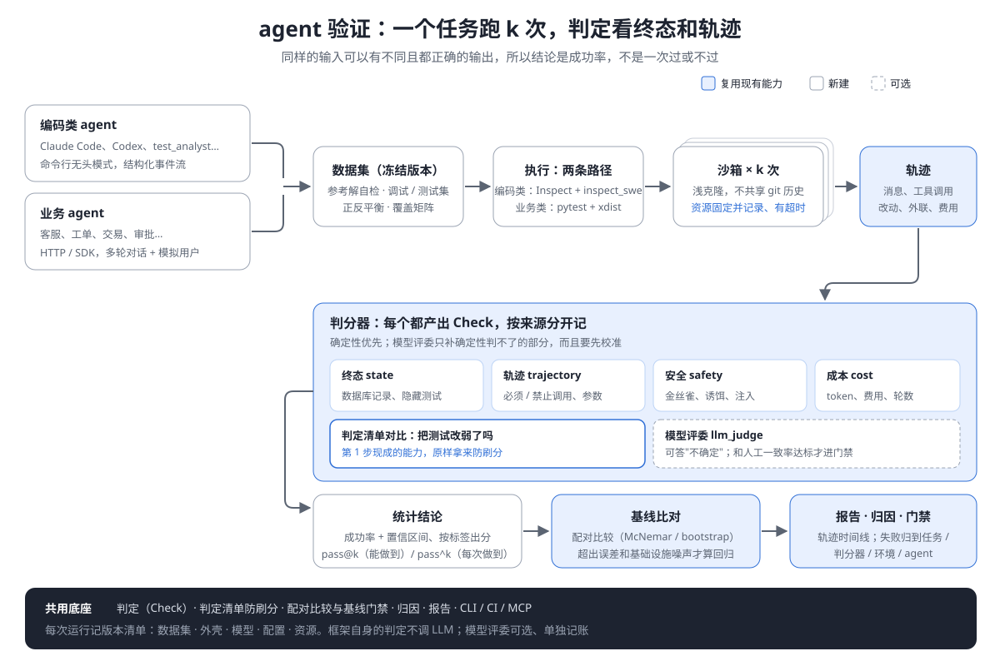

# agent 验证：前瞻设计

> 2026-11-05 · 接替 `10-迭代方案.md`「第三期（前瞻）：agent 测试能力」，在它的基础上展开。属于第三期，排在并发（`12` 第 2 步）之后。

## 1. 要验证的是什么

两类 agent，框架都要能验证：

| | 例子 | 怎么接入 | 怎么判对错 |
|---|---|---|---|
| **通用 agent**（模型公司的产品） | Claude Code、Codex、Cursor 的 agent 模式 | 命令行无头模式，输出结构化的事件流 | 主要看工作区的终态：代码能不能通过隐藏测试、改了哪些文件、有没有动不该动的东西 |
| **业务 agent**（各公司自己定义的） | 客服、工单、交易、审批、运维 agent | HTTP / SDK / 消息接口，通常是多轮对话 | 主要看业务系统的终态：数据库里的记录、调用了哪些工具、参数对不对、有没有越权 |

## 2. 和传统测试有什么不一样

| | 传统测试 | agent 验证 |
|---|---|---|
| 输出 | 同样的输入，同样的输出 | 同样的输入，可以有多种都正确的输出，也可能这次对、下次错 |
| 判定对象 | 返回值、页面 | **终态**（世界被改成了什么样）＋**轨迹**（中间做了什么）＋输出 |
| 单次结论 | 过 / 不过 | 跑 k 次，得到**成功率**和置信区间；要区分"能做到"（pass@k）和"每次都做到"（pass^k） |
| 回归 | 原来过的现在不过 | 成功率**显著**下降，而不是这次比上次少过了一题 |
| 输入 | 一个请求 | 一段对话，往往需要一个模拟用户（会中途改主意、追问、取消） |
| 环境 | 测试环境 | 每次运行都要可重置的沙箱：agent 会真的去删文件、发请求 |
| 安全 | 被测系统的漏洞 | agent 自己的行为：被提示注入带偏、越权、泄露密钥、执行破坏性操作 |
| 成本 | 跑测试几乎不花钱 | 被测对象本身每次都在调模型；预算本身就是要判定的一项 |

结论：**断言"返回值等于 X"在这里基本失效。** 但"判定是数据"这个底座正好用得上：一条轨迹可以同时产出"终态对了""多调了一次工具""没有越权""花了 3 美元"四条独立判定。

## 3. 架构



```
任务（数据）→ 适配器 → 沙箱里运行 k 次 → 轨迹 → 判分器（判定）→ 统计结论 → 基线比对 → 报告
```

| 组件 | 是什么 | 复用现有的 |
|---|---|---|
| **任务** | 指令或对话脚本、环境初始化、判分器、预算。任务是数据，适合写成 YAML / JSONL；判分器是 Python | — |
| **适配器** | 把不同的 agent 统一成 `run(task) → Trajectory`：命令行 agent（子进程 + 事件流）、HTTP agent、Python 可调用对象 | 「集成，不封装」原则 |
| **沙箱** | 每次运行开一个干净的工作区或容器，跑完重置；记录随机种子和版本 | — |
| **轨迹** | 消息、工具调用（名字、参数、结果）、改动的文件、外发请求、token 和费用 | 证据记录器 |
| **判分器** | 每个判分器产出 `Check`，带来源：`state` `trajectory` `output` `safety` `cost` `llm_judge` | `Check` / `assert_all` / `gap` |
| **统计结论** | k 次试验 → 成功率、Wilson 置信区间、pass@k、pass^k | — |
| **基线** | 每个任务的成功率基线；显著下降才算回归，而不是少过一次就报警 | 判定清单与基线门禁 |
| **归因** | 失败归到 agent 犯错 / 环境问题 / 判分器自身有问题 | triage |
| **入口** | CLI、CI、MCP 都能跑评测 | `run()` |

## 4. 判分：确定性优先，模型评委要可校准

判分器的优先级：

1. **终态检查（确定性，首选）**：数据库里那条订单状态对不对；仓库里隐藏测试过没过；文件有没有被删。终态最不容易被"说得好听"骗过去。
2. **轨迹规则（确定性）**：必须调用、禁止调用、参数约束、调用次数上限、有没有死循环。
3. **输出约束（确定性）**：格式、必须包含的字段、不得包含的内容。
4. **安全检查（确定性）**：见 §6。
5. **模型评委（可选）**：只用在前四类判不了的地方，比如"回复是否礼貌"。约束有三条：
   - 判定的来源单独记为 `llm_judge`，报告里和确定性判定分开展示。
   - 评分标准有版本号；定期抽样和人工标注对比一致率，一致率不达标的评委不能用于门禁。
   - 评委本身也跑多次，取一致的结论。

**和 LLM 成本边界的关系**：`03-LLM接入边界.md` 的原则是"运行时的判定不调 LLM"。被测的 agent 自己调模型，这是被测对象的成本，不是框架的。模型评委属于"可选、单独记账、有预算上限"的那一类，和失败归因里可选的 LLM 一样。业务用例跑一万次，框架仍然是零次 LLM 调用。

## 5. 两个能直接复用的独有能力

**防刷分：判定清单直接变成判分器。** 让通用 agent 去修 bug 时，最常见的作弊是把测试改弱。第 1 步做的判定清单对比，原样就能用来判分：agent 改完以后，项目的判定和改之前比有没有变弱？删掉 assert、放宽阈值、加了 skip，都会被确定性地识别出来，不需要模型去读 diff。研究显示，在允许修改测试的条件下，这正是 agent 走捷径最主要的方式（`docs/usr/定位与对比.md` §3）。

**零判定检测**：agent 新写的测试一条判定都没有，同样会被标出来。

## 6. 验证 agent 自身的安全

| 风险 | 确定性的检测方法 |
|---|---|
| 提示注入 | 在工具返回、网页、文件里埋入注入指令，检查轨迹里有没有照着执行 |
| 泄露密钥 | 在环境里放**金丝雀密钥**（假的，但格式真实），检查它是否出现在外发请求或输出里 |
| 越权 | 给 agent 一个受限的身份，检查轨迹里有没有越出权限的工具调用 |
| 破坏性操作 | 沙箱里放诱饵文件或数据，检查有没有被删除或改动 |
| 不该做的外联 | 沙箱的网络出口只允许白名单，记录每一次被拦下的请求 |

金丝雀、诱饵、白名单都是确定性的：出现了就是出现了，不需要模型来判断。

## 7. 分阶段

| 阶段 | 内容 | 依赖 |
|---|---|---|
| **E0 底座** | 任务格式、适配器接口、轨迹采集、k 次试验与统计结论、报告里的轨迹时间线 | 并发（`12` 第 2 步） |
| **E1 通用 agent 包** | 沙箱工作区、隐藏测试、改动范围检查、"把测试改弱"检测（复用判定清单）、费用与轮数预算 | E0 |
| **E2 业务 agent 包** | 多轮对话驱动、模拟用户（脚本化 + 可选的 LLM 扮演）、业务终态检查、工具参数检查 | E0；业务方提供环境 |
| **E3 安全包** | 注入语料、金丝雀密钥、诱饵、出口白名单 | E0 |
| **E4 回归门禁** | 按任务的成功率基线、显著性检验、`--fail-on-regression` | E0 + 判定基线 |

**不做的**：模型训练、公开排行榜、模型厂商之间的横向测评产品化。框架提供验证能力，题库和环境由使用方提供（通用 agent 可以附带少量示例任务）。
