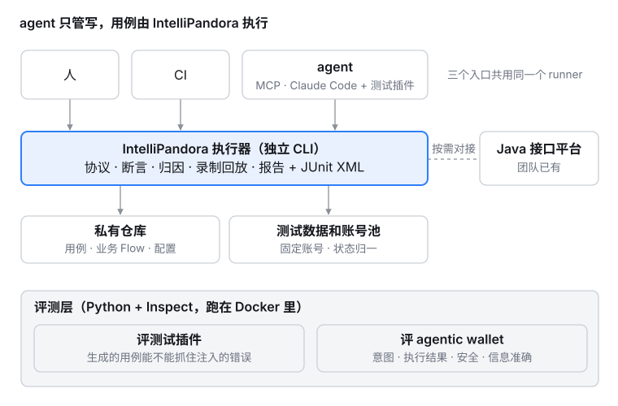

# 架构

这是当前架构的唯一一份描述，随代码一起更新。为什么这样设计，以及过去的取舍，见 [决策记录](decisions/README.md)。



## 一句话

在 pytest 之上做判定：用例照样是 pytest 用例，框架额外记下**每条用例实际做了哪些判定**，并回答"这次通过可不可信"。HTTP、Web、并发、图像都通过同一条路回到同一份结果里。

## 入口

三个入口调用同一个 `core.runner.run()`，跑出来的结果一致：

| 入口 | 代码 | 说明 |
|---|---|---|
| 命令行 | `run/commands/` | `ipandora run`、`ipandora init`、`ipandora mcp` |
| MCP | `core/mcp/server.py` | `run_tests` / `explain_failure` / `list_runs` / `build_report`，给 agent 用 |
| 库 | `core/runner/api.py` | `run(selector, env, workers, timeout, baseline, update_goldens)` |

## 一次运行

```
run()
 ├─ 叠加 conf/<env>.yaml；设置字节码缓存、制品目录等进程环境
 ├─ pytest.main(-p ipandora.core.runner.plugin  [-n N]  [--timeout S]  [Playwright 选项])
 │    每个执行用例的进程里（串行时是本进程，并行时是每个 xdist worker）：
 │    core/runner/plugin.py
 │      ├─ 记录判定：assert_all 的 Check、成立的 assert、pytest.raises / warns、
 │      │           Playwright expect（core/web.py）、matches_golden（core/assertion/visual.py）
 │      ├─ 记录证据：HTTP 请求与响应、截图、trace、基准图 / 实际 / 差异图
 │      ├─ 用例声明：dims、flaky、标题、是否可判、覆盖轴
 │      ├─ 独占资源：@pytest.mark.resource 的跨进程锁
 │      └─ 用例结束时，全部写进 teardown 报告的 user_properties
 │    主进程：core/runner/collector.py 只读报告，按收集顺序组装 CaseResult
 ├─ RunResult
 ├─ 与判定基线比对（core/runner/inventory.py，conf/judgements.json）
 ├─ 记住通过的用例里定位器指向的元素（core/web.py，供下次归因）
 └─ 存档（core/runner/store.py），供 explain_failure 取回
```

串行和并行走同一套代码，区别只在于执行用例的进程有几个。

## 模块

| 目录 | 职责 |
|---|---|
| `core/assertion/` | 判定：`Check` 是值不是异常；`field()` / `that()` 用 Python 运算符严格比较；`assert_all` 一次报出全部失败；`require()` 是前置条件；`eventually()`（`wait.py`）在截止时间内反复读，判定最终一致；`visual.py` 做图像判定 |
| `core/runner/` | 执行：`api.py` 入口，`plugin.py` 在用例进程里记录，`collector.py` 在主进程组装，`inventory.py` 判定清单与基线，`store.py` 存档 |
| `core/evidence/` | 每条用例的证据槽，按线程区分；`concurrently()` 会把它绑定到自己启动的线程 |
| `core/protocol/http/` | HTTP 层：传输策略（超时、重试、TLS）、响应解析 |
| `core/web.py` | Playwright 原样使用；把 expect 记为判定；区分"选择器过时"和"元素真的没了"；把 `web.*` 配置映射为 pytest-playwright 的默认选项 |
| `core/auth.py` | 身份与提供者：`identity()` 选择会话，提供者登录并缓存凭据，提前刷新，未登录时重新登录并重放一次；运行结束清空 |
| `core/concurrency.py` | `concurrently()`：同时起跑，复制登录态，绑定证据，判断并发是否真的发生 |
| `core/eval/` | 评测 agent（E0）：数据集与内容哈希、试验与判分（必需 / 权重 / 模型评委不计入）、统计（Wilson、pass@k、pass^k、McNemar、分层 bootstrap）、评测基线、人工标注、评测报告视图（`conf/static/eval.html`）。见 `docs/guide/eval.md` |
| `core/triage/` | 失败归因，规则优先：defect / contract / environment / data / harness / unknown |
| `core/report/` | 同一份 ReportData 生成 HTML、JSON、JUnit XML；凭据脱敏。首屏结论由 `model.py` 按计数拼出；`compare.py` 对比传入的报告或本机存档里的上一次运行（框架不存历史，本机存档由 `history.py` 写，最多 50 次）。对比基线的拆分在 `runner/inventory.py` 的 `against()`。`merge.py` 把多个分片的 report.json 合并成一份：同一用例只计一次，分片间结论不一致时列出并取更严重的结论 |
| `core/schedule/` | 配置分层（包默认 → 项目 `conf/config.yaml` → `conf/<env>.yaml`）、`Runtime`、HTTP 会话 |
| `ai/` | 可选的 LLM 归因。**`core/` 不得 import `ai/`**，由 `scripts/check_layering.py` 检查；`rm -rf src/ipandora/ai` 之后整个测试套件仍须全绿 |
| `templates/` | `ipandora init` 写进新项目的文件 |

## 不变式

这些规则都有门禁守着，不是约定：

| 不变式 | 门禁 |
|---|---|
| `core/` 不依赖 `ai/` | `scripts/check_layering.py`；CI 的 `test-without-ai` 作业删掉 `ai/` 后跑全量测试 |
| 判定不调 LLM | 同上：LLM 只在运行结束后、可选地参与归因 |
| 并行和串行的判定清单逐字节一致 | `test/testrunner/test_parallel.py` |
| 每个第三方组件都登记在案、版本一致、发布满 14 天、许可证在白名单内 | `scripts/check_components.py`、`scripts/update_locks.py`、`.github/workflows/security.yml` |
| 必需的数据文件真的进了 wheel | `scripts/check_packaging.py` |
| 文档链接有效，参考文档和代码一致 | `scripts/check_docs.py` |
| 文档里的代码真的能跑 | `test/testdocs/` |
| 仓库里没有凭据 | `scripts/check_secrets.py` |

## 可选组

内核只依赖 8 个包。其余能力都放在可选组里，不装就不会引入对应的依赖：

| 组 | 提供 | 组件 |
|---|---|---|
| `[parallel]` | `--workers`、`--timeout` | pytest-xdist、pytest-timeout |
| `[web]` | Web 自动化 | playwright、pytest-playwright |
| `[visual]` | 图像判定 | pillow、pixelmatch |
| `[mcp]` | MCP 入口 | mcp |
| `[ai]` | LLM 归因 | anthropic |

所有组件见 [组件登记表](../security/components.md)。
