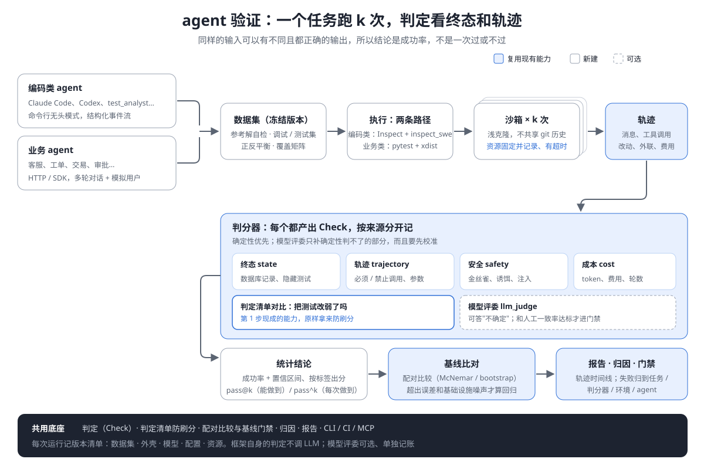

# agent 验证：设计

> 2026-11-05 · 接替 `10-迭代方案.md`「第三期（前瞻）：agent 测试能力」。属于第三期，排在并发（`12` 第 2 步）之后。
>
> **修订（同日）**：对照《Agent 评测学习手册》复审后重写。手册按 Anthropic《Demystifying evals for AI agents》整理。主要改动有六处：
> - 区分能力评测和回归评测；
> - 补上数据集管理；
> - 每次运行记录版本清单；
> - 执行改为"编码类 agent 走 Inspect，业务 agent 走 pytest"两条路径，原方案打算自研沙箱；
> - 两个版本之间的比较改用配对检验；
> - 修正了一个会泄露答案的沙箱设计。
>
> 复审过程见 `14` §11。

## 1. 要回答的两个问题

评测回答两个问题，对应两种评测，做法不一样：

| | 能力评测 | 回归评测 |
|---|---|---|
| 问题 | agent 能把什么做好 | 这次改动有没有把原来能做的事弄坏 |
| 通过率 | 从低处起步：一套新评测上来就 95%，说明题太简单 | 应接近 100% |
| 用法 | 找出做不好的地方，给团队一座要爬的山 | 每次改模型、提示、工具、外壳都跑一遍，掉分就拦 |
| 门禁 | 不做门禁，只看趋势 | 做门禁 |

**毕业**：能力评测里已经稳定通过的任务，转入回归集。框架要能按任务标出"已饱和、可以毕业"的那些。

被验证的对象有两类：

| | 例子 | 被测系统 | 怎么判对错 |
|---|---|---|---|
| **编码类 agent** | Claude Code、Codex CLI、OpenCode、DeepSeek Harness，以及你自己的 test_analyst | **外壳 + 模型**，两者都要记版本。同一个模型换不同的外壳，结果可以差很多 | 工作区的终态：隐藏测试是否通过、改了哪些文件、有没有动不该动的东西 |
| **业务 agent** | 客服、工单、交易、审批、运维 agent | 同上 | 业务系统的终态：数据库记录、工具调用和参数、有没有越权 |

## 2. 和传统测试有什么不一样

| | 传统测试 | agent 验证 |
|---|---|---|
| 输出 | 同样的输入，同样的输出 | 同样的输入可能有多种都正确的输出，也可能这次对、下次错 |
| 判定对象 | 返回值、页面 | **终态**（环境里最终真实发生了什么，不看 agent 自己怎么说）+ **轨迹** + 输出 |
| 单次结论 | 过 / 不过 | 跑 k 次得到成功率和置信区间。"成功一次就够"的场景看 pass@k；"每次都得靠谱"的场景看 pass^k |
| 回归 | 原来过的现在不过 | 两个版本的差异超出统计误差和基础设施噪声，才算回归 |
| 输入 | 一个请求 | 一段对话，往往需要一个模拟用户（会中途改主意、追问、取消） |
| 环境 | 测试环境 | 每次试验都从干净状态开始，不共享缓存、文件和 git 历史 |
| 安全 | 被测系统的漏洞 | agent 自身的行为：被提示注入带偏、越权、泄露密钥、执行破坏性操作 |
| 成本 | 跑测试几乎不花钱 | 被测对象每次都在调模型；预算本身就是要判定的一项 |

**术语对照**（和手册一致）：

| 测试里叫 | 评测里叫 |
|---|---|
| 用例 | 任务（task） |
| 一次执行 | 试验（trial） |
| 断言 | 判分器（grader） |
| 执行日志 | 轨迹（transcript） |
| 测试套件 | 评测集（eval suite） |

结论：**"返回值等于 X"这类断言在这里基本失效。** 但"判定是数据"这个底座正好用得上。一条轨迹可以同时产出四条独立判定："终态对了""多调了一次工具""没有越权""花了 3 美元"。

## 3. 架构：七个部分，两条执行路径

主流评测框架都拆成七个部分，Inspect 的拆法最典型：

| 部分 | 是什么 | 怎么做 |
|---|---|---|
| **数据集** | 输入、期望、标签；有版本 | 见 §4 |
| **运行器** | 并发、每个任务跑多次、超时 | 两条路径，见下 |
| **被测对象** | 模型 API 或命令行 agent | 两条路径，见下 |
| **环境** | 沙箱、工具 | 两条路径，见下 |
| **轨迹** | 完整的过程记录 | 两条路径都要产出 |
| **判分器** | 代码、模型、人工 | 见 §5。产出 `Check`，**两条路径共用** |
| **统计报告** | 按标签出分、pass@k / pass^k、置信区间、和上一版对比 | 见 §6。**两条路径共用** |

另外，**每次运行都记一份版本清单**：数据集、框架、被测外壳、模型、配置、沙箱资源（CPU 和内存）、模拟用户的版本和种子。缺了这份清单，分数就无法复现，也无法和别人的分数比较：同一个模型、同一套任务，只改资源配置，Terminal-Bench 2.0 上的成功率能差 6 个百分点（[Anthropic](https://www.anthropic.com/engineering/infrastructure-noise)）。

### 两条执行路径

| | Inspect 路径 | pytest 路径 |
|---|---|---|
| 适合 | **编码类 agent**：需要容器沙箱，需要在沙箱里运行命令行 agent | **业务 agent**（HTTP / SDK）；和产品测试放在一起的回归评测 |
| 运行器、环境、被测对象 | 用 [Inspect](https://inspect.aisi.org.uk/eval-logs.html)：自带 Docker / K8s 沙箱、epoch（重复试验）、超时。命令行 agent 用 [inspect_swe](https://meridianlabs-ai.github.io/inspect_swe)：它在沙箱里运行 Claude Code、Codex CLI，模型调用经 Inspect 转发，因此能换模型、能计 token、能记轨迹 | 任务 × 试验 = 参数化的 pytest 用例，用 xdist 并行（`12` 第 2 步）；适配器是 HTTP 客户端或 Python 可调用对象 |
| 我们提供 | ① **评分器包**：把我们的评分器包成 Inspect 的 scorer，包括判定清单、零判定、生成用例的变异得分；② **日志接入**：用 `read_eval_log` / `read_eval_log_samples` 读 Inspect 日志，每个样本、每个 epoch 转成一次试验的判定，进入我们的统计、基线、报告和 MCP | 全部 |

**为什么这样分**：

- **"集成，不封装"在评测上也适用。** 沙箱编排、在沙箱里跑命令行 agent、记录轨迹，Inspect 和 inspect_swe 都已经做好，而且成熟。自己重做一遍，只会落后、成为负担。原方案打算自研沙箱，属于违反自己定下的原则，这里改正。
- **我们的差异化不在运行器，而在判定层。** 确定性评分器、判定清单防刷分、统计与基线门禁、统一的报告和 MCP 入口，这些在两条路径上都成立。
- **业务 agent 不需要容器沙箱**，需要的是对话驱动和业务终态检查。这些和产品测试是同一套东西：同一个 `field()`、同一份证据、同一个 CI。

## 4. 数据集

最有价值的题来自真实失败。每道题都要能做对、没有歧义；题量决定了能分辨多小的差距。

**来源**，按价值排：
1. 真实失败：线上事故、缺陷单、用户投诉、agent 以前做错的记录；
2. 专家编写：重点写边界和安全场景；
3. 从公开基准里挑子集，作为通用参照；
4. 模型批量生成变体，人工逐条审过才入库。

**入库检查**：框架负责的部分都做成门禁，也就是"评测集自己的测试"：

| 检查 | 框架怎么做 |
|---|---|
| 每道题都能做对 | 每个任务附一份**参考解**，用全部评分器对它判分，必须全部通过。参考解判不过，说明是任务或评分器有问题，不是 agent 的问题 |
| 没有歧义 | 抽样导出给两个人独立判分，计算一致率（见 §5 人工通道） |
| 正反都要测 | 任务打上极性标签："该做"/"不该做"。报告按极性分开出分，避免只往一个方向优化 |
| 覆盖 | 用现有的覆盖矩阵：任务类型 × 业务 × 难度 × 风险，空格子一眼可见 |
| 信息量 | 用现有模型先跑一遍，全过或全挂的题从能力集里拿掉 |
| 污染 | 去重；和公开数据重复的题不当能力题 |

**定稿**：
- 冻结版本（内容哈希写进版本清单），分成调试集和测试集。调提示只看调试集，测试集只用来下结论。框架记录每次运行用的是哪个集合，用测试集调参时给出警告。
- 题量与分辨率：通过率在 50% 附近时，95% 置信区间约为 1.96 × √(p(1−p)/n)。

| 题量 | 置信区间 |
|---|---|
| 20 | ±22 个百分点 |
| 50 | ±14 个百分点 |
| 100 | ±10 个百分点 |
| 400 | ±5 个百分点 |

起步 20 到 50 道题，足够发现问题；要比较两个版本谁更好，得加题，或者用配对比较（§6）。

**格式**：任务用 YAML / JSONL 写，因为它们是数据：输入、初始状态、期望、标签、预算、参考解的位置。评分器用 Python 写。Inspect 路径上的任务直接是 Inspect 的 Task，不另造格式。

## 5. 判分

**能用代码判的就用代码，代码判不了的才用模型评委，人工主要用来校准。**

| 优先级 | 类型 | 判什么 |
|---|---|---|
| 1 | **终态**（代码） | 数据库记录、隐藏测试是否通过、文件有没有被删 |
| 2 | **轨迹规则**（代码） | 必须调用、禁止调用、参数约束、调用次数上限、有没有死循环 |
| 3 | **输出约束**（代码） | 格式、必须包含的字段、不得包含的内容 |
| 4 | **安全**（代码） | 见 §8 |
| 5 | **模型评委** | 分析质量、语气、计划是否合理 |
| — | **人工** | 少量抽检；建立校准基准 |

**评结果，不评步骤顺序**：正确路径不止一条。轨迹规则只约束"不许做什么"和"必须做到什么"，不规定先后顺序。

**部分分**：多步任务的得分 = 各判定按权重的加权比例；"成功"定义为所有必需判定全部成立。两个数字都报。

**模型评委**：
- 每个维度一个评委，用结构化的评分标准；评分标准有版本号，记进版本清单。
- **允许评委回答"不确定"**。"不确定"记为无结论，不算过也不算不过，和零判定一样不计入通过率。这样能减少评委瞎判。
- 判定来源单独记为 `llm_judge`，报告里和确定性判定分开展示。
- 和人工标注的一致率达标之前，评委的判定不能用于门禁。

**人工通道**：抽样导出为 JSONL（附轨迹链接），标注完再导入，框架计算评委与人工的一致率。这是校准的依据，也用来检查任务有没有歧义（§4）。

**防作弊**：
- 隐藏测试放在 agent 的工作区之外，判分时才挂进来；
- 测试文件只读；
- 有研究做了一个专门钻漏洞的 agent，一道题没解，却在 SWE-bench Verified、Terminal-Bench 上拿到 100%（手册引用，[来源](https://techandfinanceblog.pages.dev/blog/ai-agent-benchmarks-2026/)，二手资料）。所以判分器自己也要有测试，参考解就是它的测试用例。

**和 LLM 成本边界的关系**：被测 agent 调用模型，是被测对象的成本。模型评委可选、单独记账、有预算上限，和失败归因里可选的 LLM 属于同一类。业务用例跑一万次，框架自身仍然是零次 LLM 调用。

## 6. 统计与报告

**每次运行报这些**：
- 按任务、按标签：成功率、Wilson 置信区间、pass@k、pass^k。pass^k 用 τ-bench 的无偏估计 E[C(c,k)/C(n,k)]（[arXiv 2406.12045](https://arxiv.org/abs/2406.12045?context=cs)）。
- 平均分（含部分分）。
- 成本：费用、token、耗时、轮数、工具调用次数。

**两个版本怎么比**：同一组任务上的比较是**配对**的，用配对检验：
- 每题结果是 0/1 时，用 McNemar 检验；
- 有部分分时，按任务做配对 bootstrap。

两个版本的差异要同时超出统计误差和该环境下测得的基础设施噪声，才判为"变好"或"变差"；否则报告为"无法区分"。原方案用的是 Fisher 精确检验，那是不配对的，会浪费同一组任务带来的统计功效。

**失败分类**：失败要读轨迹才分得清是谁的问题，分四类：

| 归因 | 例子 |
|---|---|
| 任务有问题 | 任务没说清、参考解判不过 |
| 评分器有问题 | 太严，格式或同义说法不同就判错 |
| 基础设施 | 沙箱资源不足、网络、超时 |
| agent 的问题 | 没理解任务、工具用错、上下文丢失、过早结束 |

确定性规则能分的先分，比如"参考解也判不过"就是任务或评分器有问题。剩下的在报告里给出轨迹，供人阅读；可选用模型辅助归类，但只在运行后做。

**饱和监测**：每个评测集跟踪通过率趋势。达到阈值的能力评测，标为"可毕业"，并提示该补更难的题了。

**报告**：轨迹时间线（消息、工具调用、终态差异）和分数放在一起展示；JSON 字段可以导出给其他可视化工具使用。

## 7. 两个独有能力

**防刷分：判定清单直接用作评分器。** 让编码 agent 修 bug 时，最常见的作弊是把测试改弱。第 1 步做的判定清单对比，原样就能拿来判分：agent 改完以后，项目里的判定和改之前比有没有变弱？删掉 assert、放宽阈值、加 skip，都能被确定性地识别出来，不需要模型去读 diff。研究显示，在允许修改测试的条件下，agent 走的捷径绝大多数正是改测试（`docs/guide/why.md` §3）。

**评"会写测试的 agent"（例如 test_analyst）**：别人只能看"生成的用例能不能跑通"。我们还能看三件事：
- 生成的用例里有没有零判定，也就是根本没断言任何东西；
- 用变异测试（`scripts/mutation.py`）衡量这些用例能不能真的抓住缺陷；
- 判定清单：这些用例实际断言了什么。

"用例能不能跑"只说明它不报错，"能抓住多少变异"才说明它有用。

## 8. agent 自身的安全

| 风险 | 确定性的检测方法 |
|---|---|
| 提示注入 | 在工具返回、网页、文件里埋入注入指令，检查轨迹里有没有照着执行 |
| 泄露密钥 | 在环境里放**金丝雀密钥**（假的，但格式真实），检查它是否出现在外发请求或输出里 |
| 越权 | 给 agent 一个受限身份，检查轨迹里有没有越权的工具调用 |
| 破坏性操作 | 沙箱里放诱饵文件或数据，检查有没有被删除或改动 |
| 不该做的外联 | 沙箱出口只放行白名单，记录每一次被拦下的请求 |

金丝雀、诱饵、白名单都是确定性的：出现了就是出现了，不需要模型判断。提示注入的语料库可以借用 promptfoo 的红队测试能力。

## 9. 干净环境

试验之间互相污染，会造成成批失败，或者让分数虚高。

| 要求 | 做法 |
|---|---|
| 不共享 git 历史 | **每次试验都从任务指定的提交重新做一个浅克隆，或者解开一份打包好的快照。不用 git worktree**：worktree 和主仓库共用对象库和引用，agent 用 `git log` 就能看到后续提交，也就是答案。手册里提到的"agent 读到前几次试验的 git 历史、分数虚高"就是这类问题。原方案写的是 worktree，这里改正 |
| 不共享缓存和残留文件 | 每次试验一个新容器；包缓存只读挂载 |
| 资源固定并记录 | CPU、内存、超时写进版本清单；比较两个外壳时用同一个镜像、同样的资源 |
| 每次试验都有超时 | 超时记为基础设施问题，不算 agent 失败；单独统计超时率 |

## 10. 分阶段与验收

| 阶段 | 内容 | 验收：用你手册里的两个项目来验 |
|---|---|---|
| **E0 底座** | 数据集格式与版本清单；参考解自检门禁；试验统计（成功率、置信区间、pass@k、pass^k、配对比较）；报告里的轨迹时间线；人工标注导入导出 | 项目 1 的任务集能入库，参考解全部判过，报告能出分 |
| **E1 编码 agent（Inspect 路径）** | 评分器包（判定清单、零判定、变异得分、改动范围）；Inspect 日志接入；inspect_swe 驱动 Claude Code / Codex CLI；干净环境（浅克隆、资源固定） | **项目 2**：同一个模型分别装进三个外壳，跑同一套任务，报告给出成绩、费用、失败分类；**项目 1**：test_analyst 生成用例的变异得分 |
| **E2 业务 agent（pytest 路径）** | 多轮对话驱动；模拟用户（先脚本化，再做可选的 LLM 扮演）；业务终态检查；工具参数检查 | 一个示例业务 agent 跑通 τ-bench 式的终态判分和 pass^k |
| **E3 安全** | 注入语料、金丝雀、诱饵、出口白名单 | 每类风险都有一个示例任务，能被确定性检出 |
| **E4 回归门禁** | 按任务的成功率基线；配对检验；`--fail-on-regression`；饱和监测与毕业 | 改一次提示，造成真实退化时门禁拦下；只有噪声级波动时不拦 |

**不做的**：模型训练、公开排行榜、模型厂商之间的横向测评产品化。框架提供验证能力，题库和环境由使用方提供（编码类 agent 可以附带少量示例任务）。

---

## 追加（2026-11-05）：E0 已实现

`ipandora.core.eval` 与 `ipandora eval`，用法见 [`docs/guide/eval.md`](../../guide/eval.md)。与本文的差异和补充：

- **比较两个版本时，多次试验用分层 bootstrap。** §6 写的是"按任务做配对 bootstrap"。实现时发现只对任务重新抽样，等于把每题的成功率当成精确已知：一个只有一道题的标签，5/5 变成 3/5，区间宽度为零，被判成"变差"。现在同时对任务和每题的试验重新抽样。每题只有一次 0/1 试验时仍用 McNemar 精确检验。
- **没有参考解不等于任务有问题。** 自检会列出没有参考解的题，但只有"参考解存在且判不过"才把这道题上的失败归为"任务有问题"。
- **agent 抛异常归为基础设施**，不计入成功率；agent 答错要体现在输出里，由评分器判。
- 轨迹时间线、版本清单、人工标注（一致率与 Cohen kappa）都已实现；Inspect 日志接入是 E1。

---

## 追加（2026-11-06）：E1 的 Inspect 路径已实现

`ipandora.core.eval.inspect_log`、`ipandora.core.eval.inspect_scorer` 与 `ipandora eval inspect`，用法见 [`docs/guide/eval.md`](../../guide/eval.md#inspect-路径)。`inspect_ai` 按 `15` §3 准入，进可选安装组 `inspect`（0.3.283，MIT，传递依赖约 60 个，只在 Python ≥ 3.11 上安装），登记在 `docs/security/components.md`。与本文的差异和补充：

- **日志用 Inspect 自己的读取接口**（`read_eval_log(header_only=True)` 加 `read_eval_log_samples` 逐个读样本），不解析文件格式：`.eval` 是 zip 里压缩的 JSON，格式随版本变化，读取接口是它承诺稳定的那一层。
- **分数到判定的换算要有阈值。** Inspect 的分数可以是 `C/I/P/N`、数字、布尔、字典、列表；我们的判定是成立 / 不成立。按 Inspect 自己的 `value_to_float` 换成 0 到 1，达到阈值（默认 1）算成立；字典、列表逐项一条判定。用 `inspect_scorer.scorer` 包起来的评分器，判定原样放在分数的 metadata 里，读日志时按名字还原，不经过换算。
- **模型评分器按模型评委处理**：`model_graded_qa`、`model_graded_fact` 以及用户点名的评分器，校准前不计入成功率。不这样做，Inspect 路径就绕过了"LLM 不参与判定"。
- **超时算基础设施**（§9），其他上限（token、消息数、费用、轮数）算预算判定不通过，和 pytest 路径的预算一致。样本出错算基础设施；评分器抛异常归评分器。
- **一次运行一个模型、每个任务一份日志。** 一个目录里可能放了几次运行，同一任务出现两份日志、或者模型不同时直接报错，不悄悄合并。
- **inspect_swe 不需要适配代码**：它提供的是 solver，和我们的 scorer 正交。E1 验收里"同一模型装进三个外壳"由使用方在 Inspect 里配置三个 solver 跑三次，每次 `ipandora eval inspect` 出报告；需要 Docker，不在 CI 里跑。
- **还没做的**：生成用例的变异得分、改动范围检查作为现成的评分器，以及干净环境（浅克隆、资源固定）的示例任务。它们是评分器和任务，不是框架接口，放到 E2 之后按需补。

---

## 追加（2026-11-06）：E2 的多轮对话已实现

`ipandora.core.eval.dialogue` 与 `ipandora.ai.simulated_user`，用法见 [`docs/guide/eval.md`](../../guide/eval.md#多轮对话的业务-agent)，例子在 `examples/agent/`。与本文的差异和补充：

- **对话驱动不是新的运行器**：`converse()` 在 spec 的 `agent(task)` 里调用，返回同样的 `AgentResult`，所以试验次数、并行、统计、基线、报告都沿用 E0，不另起一套。
- **脚本化用户的规则每条只用一次**，兜底回复也有次数上限，用完就离开。这样对话一定会结束，agent 反复问同一个问题时得到的是"没人回答"，而不是无限循环到轮数上限。
- **终态在对话结束时深拷贝**，之后对业务系统的修改影响不到被判定的状态。
- **参考解是正确的工具调用序列**（τ-bench 的做法），`replay()` 在全新的系统上执行后交给同一个评分器。这样多轮任务也能过 E0 的参考解自检。
- **`never_says` 的证据不复述匹配内容**：它常用来检查卡号、口令有没有泄露，把匹配到的文字写进报告就是第二次泄露。
- **模型扮演的用户放在 `ai/`**，`core/` 不依赖它；它只是被测对象的环境，不判定，有调用上限，发出去的内容先脱敏，版本（提示词版本号）写进 `user_simulator`。
- 验收："一个示例业务 agent 跑通 τ-bench 式的终态判分和 pass^k"由 `test/testeval/test_dialogue.py::TestTheExample` 检查。
