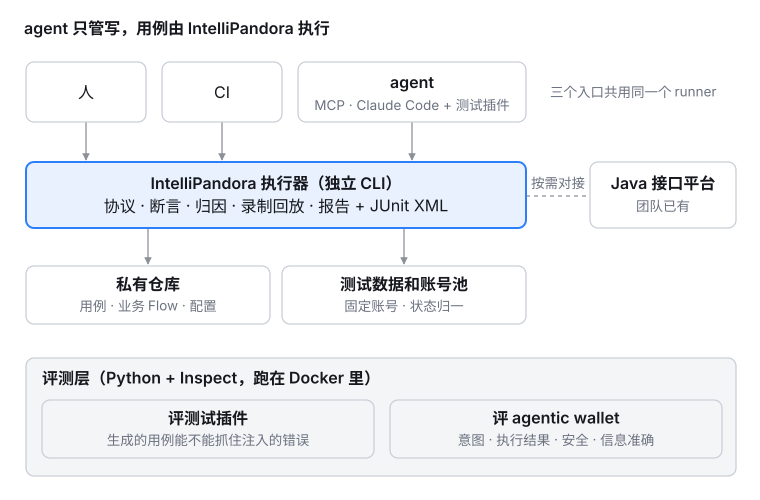
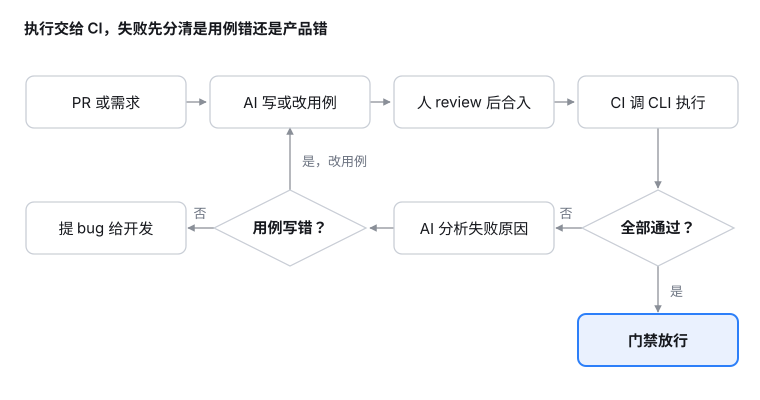

# 开发手册

## 1.基础
- **语言**
> **PYTHON 3.10+**（代码用了 PEP 604 的 `int | list[int]`，3.7 从来跑不起来）

- **版本管理**
> ***CHANGELOG*** 内按格式添加版本内容

- **安装开发环境**
> 与 CI 装的是同一批文件：锁定版本，逐个校验哈希。
    ```shell script
    make install          # requirements/ci.txt + 可编辑安装本项目
    make install-tools    # pip-audit、bandit、build、uv 等，requirements/tools.txt
    ```
  > 加依赖或改版本范围：先按 [`docs/design/15`](../design/15-第三方组件安全准入与漏洞扫描.md) §3 做准入审查，在 [`docs/security/components.md`](../security/components.md) 登记，再 `make locks` 重新生成锁文件。锁文件只接受发布满 14 天的版本。没登记，CI 的 `Components are registered` 会失败；没重新生成锁文件，CI 装不上新依赖。

- **编译发布**
> **只通过 CI 发布**：在 GitHub 上发布一个 release（标签 `vX.Y.Z`，与 `CHANGELOG` 第一行一致），`.github/workflows/release.yml` 会依次完成安全扫描、构建、版本与 wheel 内容检查、生成 SBOM、发布到 PyPI（附来源证明），最后把 SBOM 挂到 release 上。本地没有、也不应该有 PyPI 凭据。

  本地只构建、不上传：

    ```shell script
    make package          # 清理 → python -m build --no-isolation → check_packaging
    ```

  > 不要用 `python setup.py bdist_wheel`，也不要跳过清理。setuptools 会把源码复制到 `build/lib`，**但从不删除那里已有的文件**。2026-11 实测：一个旧的 `build/` 目录让新构建的 wheel 带上了 21 个已经从源码删除的模块，包括整个录制回放子系统和数据上报链路。`check_packaging.py` 现在会对比 wheel 与 `src/`，发现源码里没有的文件就失败。

  **一次性设置（需要仓库管理员）：**

  1. PyPI → 项目 intellipandora → Publishing → 添加 GitHub 发布者：Owner `Conan-Shao`，Repository `IntelliPandora`，Workflow `release.yml`，Environment `pypi`。之后可以删掉 PyPI 上旧的 API token。
  2. GitHub → Settings → Environments → 新建 `pypi`，勾选 Required reviewers：发布前必须有人批准。
  3. GitHub → Settings → Branches → 为 `main` 添加保护规则，要求 CI 与 Security 的检查通过才能合入。

- **安全扫描**
> `.github/workflows/security.yml` 在每个 PR、每次合入 main、每天定时各跑一次：依赖漏洞（pip-audit，逐个锁文件）、自身代码（bandit）、许可证、组件登记、例外到期。规则见 [`docs/design/15`](../design/15-第三方组件安全准入与漏洞扫描.md)，对外结论见 [`docs/security/report.md`](../security/report.md)。

    ```shell script
    make security         # 本地跑同样的扫描，并更新 docs/security/report.md
    ```

  * **扫描失败怎么办**：有修复版本就升级（改范围要重新登记，再 `make locks`）；没有修复、或评估后确认不影响本框架，在 [`docs/security/exceptions.md`](../security/exceptions.md) 登记例外，写明理由和到期日。到期后 CI 会再次失败，要么升级，要么重新评估后续期。
  * **bandit 报出自身代码的问题**：能改就改。确认不构成问题的，在该行标注 `# nosec Bxxx`，并在**上一行**写 `# bandit Bxxx: 理由`。没有理由的标注会让扫描失败；每一处标注连同理由都会列在安全报告里。
  * **报告由谁更新**：每天的定时任务在结论变化时自动开一个更新报告的 PR。需要在 Settings → Actions → General 打开 "Allow GitHub Actions to create and approve pull requests"，否则只会推送 `security-report/update` 分支，需手动开 PR。这类 PR 由 GitHub 自动令牌创建，不会自动触发检查，关闭再重新打开一次即可。
  * **Dependabot**：在 Settings → Code security 打开 Dependabot alerts 与 security updates。版本更新 PR 按 `.github/dependabot.yml` 每周提一次，同样有 14 天冷静期。更新 PR 改了版本范围或动作 SHA 时，`Components are registered` 会失败，这是有意的：审查者按准入规则检查后，在同一个 PR 里更新登记表。

## 2.开发规范

###  **目录结构**
```shell
.
├── src
│   └── ipandora                # 包名是 ipandora，发行名才是 intellipandora
│       ├── CHANGELOG
│       ├── ai/                 # 可选 LLM 支持，可整包删除
│       ├── common/
│       ├── conf/               # 框架默认 config.yaml 与报告模板（用例项目的配置放它自己的 ./conf）
│       ├── core/
│       ├── run/                # 命令行
│       ├── utils/
│       └── version.py
├── scripts                     # 门禁：smoke_import / layering / secrets / packaging / mutation / components / security_report
├── requirements                # *.in 为声明，*.txt 为带哈希的锁文件（scripts/update_locks.py 生成）
├── docs
│   ├── design/                 # 设计与返工记录
│   ├── dev/
│   ├── security/               # 组件登记表、漏洞例外、安全报告
│   └── usr/
└── test
```

###  **说明**
代码都在 **`src/ipandora`**（注意：包名 `ipandora`，发行名 `intellipandora`）。

  * **core**: 核心能力
    * **protocol**: 协议层。目前只有 `http/`——传输策略、响应解析。UI（Web / App）规划中
    * **assertion**: 断言层。`Check` / `assert_all` / `require` / `gap`
    * **runner**: 库可调用的执行入口；CLI 与 MCP 都是它的薄壳。`inventory.py` 是判定清单与基线比对
    * **report**: ReportData → HTML / JSON / JUnit XML + 历史归档
    * **triage**: 失败归因，规则优先，LLM 可选
    * **evidence**: 请求响应证据采集
    * **mcp**: agent 入口
    * **plugin** / **schedule**: 插件注册、Runtime 配置。配置分层（包默认 → 项目 `conf/config.yaml` → `conf/<env>.yaml`）与深合并在 `schedule/config.py`；环境叠加只作用于一次 `run()`，结束即恢复
    * **engine/crypto**: 配置加密；密钥存放在 `~/.ipandora/crypto`，不在包内
  * **common** / **utils**: 工具
  * **run**: 命令行
  * **conf**: 配置与报告模板

### 框架设计

* 架构（入口 / 执行 / 资产 / 评测四层）



* 日常工作流



> 旧的 `framework_architecture.jpg` 与 `business_flow.png` 已删除：它们画的是还有平台数据上报、还有 pandora runner、还有代码自动生成的时代，那三样都已归档。

### **开发手册**
  * [IntelliPandora开发手册(完善中)](./Python_Dev_Standard.md)

## 3.单元测试
> test目录下编写单元测试用例
> 参考 test/testhttp/test_http_get.py