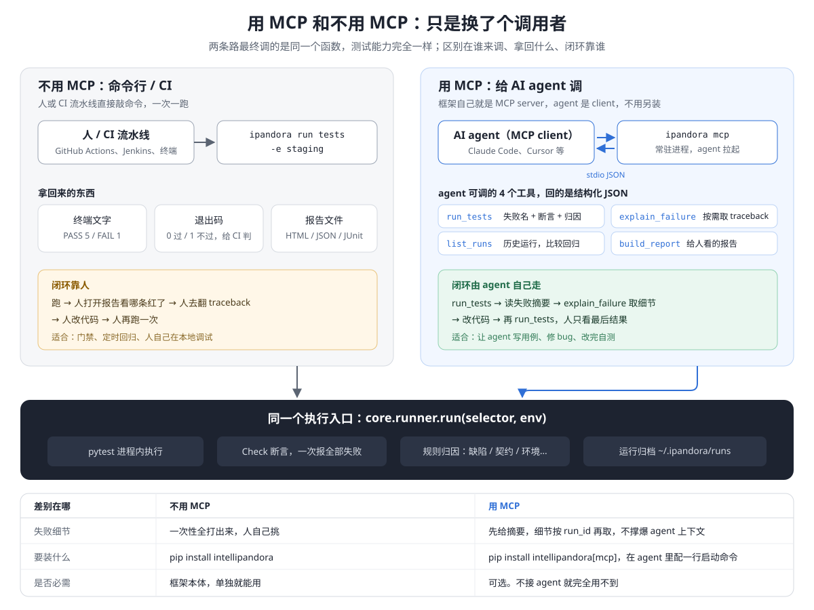

# 接入 agent

MCP 能力面，以及 `ipandora init` 生成的 AGENTS.md。

## MCP 能力面



MCP 是**可选的**：只有让 AI agent（Claude Code、Cursor 等）来跑用例时才需要。框架本身就是 MCP server，不用另外部署。它和命令行调的是同一个 `run()`，测试能力完全一样。

**接入**（在用例项目根目录下；server 会从这里读取 `./conf`）：

```shell
pip install intellipandora[mcp]
claude mcp add intellipandora -- ipandora mcp      # Claude Code
```

其他客户端配置 `.mcp.json`：

```json
{"mcpServers": {"intellipandora": {"command": "ipandora", "args": ["mcp"]}}}
```

**4 个工具**：

| tool | 用途 |
|---|---|
| `run_tests(selector, env, workers)` | 跑用例，返回摘要：失败名、断言信息、归因。`workers` 大于 1 时并行 |
| `explain_failure(run_id)` | 按需取完整失败现场（traceback、证据） |
| `list_runs(limit)` | 最近的运行，用来比较回归 |
| `build_report(run_id, directory)` | 为某次运行生成 HTML + JSON 报告，给人看 |

典型闭环：`run_tests` → 有失败 → `explain_failure(run_id)` → 改代码 → 再 `run_tests`。摘要刻意保持精简，细节按 `run_id` 再取，避免撑爆 agent 的上下文。


## AGENTS.md：给写用例的 agent 的规则

`ipandora init` 会生成一份 `AGENTS.md`，Claude Code、Codex、Cursor 等 agent 进入项目时会读它。里面的每条规则都对应一个门禁或一个报告信号，不只是一句要求：

| 规则 | 谁来发现 |
|---|---|
| 每条用例都要有判定 | 没有任何判定的通过，在报告里标为 UNVERIFIED，不计入通过率 |
| 不许为了变绿改弱判定 | 和 `conf/judgements.json` 比对；`--fail-on-weakened` 拦下 |
| 期望值确实要改时写明原因，由人接受基线 | CODEOWNERS 要求负责人审基线文件 |
| 不许重新录制基准图来通过图像判定 | 基准图哈希在判定里，换图即"判定改变" |
| 文字用文字断言判，不用截图判 | 截图看不见文字变化（实测：100.50 → 100.60 只差 7 个像素） |
| UI 定位优先用 role、label、test id | 找不到元素时，报告区分"选择器过时"和"待确认：可能是产品缺陷" |
| 前置条件不满足用 `require()` | 归因为 data，不算通过 |
| 不稳定的用例标 flaky 并写原因 | `--exclude-flaky` 时报告仍点名 |
| 共用账号的用例声明 resource | 并行时不会同时执行 |

完整内容见生成的文件本身（模板在 `src/ipandora/templates/project/AGENTS.md`）。
