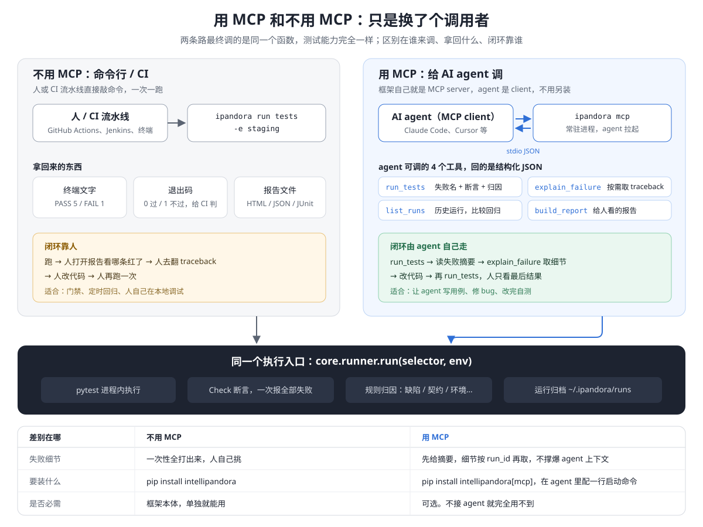

# User Guider of Pandora
`This is the user guider of Pandora.`

## 1. 安装说明

## 2. 功能介绍

### 2.1 核心功能
#### 2.1.1 Http
> 列举常见的http接口的调用实现
* **一般接口**

```python
from ipandora.core import api


class EventTrackService(object):

    @api.mark(module='eventPlatform')
    @api.http.post(path="api/event/track/queryCheckResult")
    def get_event_track_result(self, device_id, id_count_map, start_time, end_time):
        _data = {"deviceId": device_id, "startTime": start_time, "endTime": end_time,
                 "idCountMap": id_count_map}
        return dict(json=_data)

```

* **URI带参数**

```python
from ipandora.core import api


class Hit(object):

    @api.mark(module='hit')
    @api.http.post(path="v1/hits/{hitId}")
    def get_hit_detail(self, hitId, _json = None, _params = None):
        return dict(json=_json, params=_params,
                    other_params={"hitId": hitId})

```


* **文件上传**

```python
from ipandora.core import api


class ReportService(object):

    @api.mark(module='eventPlatform')
    @api.http.post(path='api/event/file/upload')
    def upload_point_log(self, _params, _file_items = {}):
        _file_params = {}
        if _file_items:
            for _k, _v in _file_items.items():
                _file_params[_k] = open(_v, 'rb')
        return dict(params=_params, files=_file_params)
```


#### 2.1.2 响应数据

`response.data` 会自动剥掉 `data` / `result` 外层包装，返回的对象**同时支持属性和键访问**：

```python
resp.data.origin           # 属性访问
resp.data['x-req-id']      # 键访问 —— 含连字符、Python 关键字的键用这种
resp.data.user.name        # 嵌套
```

字段不存在时报错会列出有哪些字段，不用去翻响应体。

**取列表数据**：

```python
resp.fetch_all()                      # 全部条目
resp.fetch_one()                      # 第一个；没有数据时返回 None
resp.filter(status='ok').fetch_all()  # 字段等于（严格：'0' 不等于 0）
resp.filter(lambda x: x['amount'] > 1000).fetch_all()   # 任意条件，直接写 Python
resp.filter(lambda x: 0 <= x['fee'] <= 100, type='A')   # 两种可以一起用
```

各种响应形态的行为：

| 响应 | `fetch_all()` |
|---|---|
| `{"data":[{...},{...}]}` | 两个条目 |
| `{"data":{...}}` | **一个**条目（不会被拆成字段值） |
| `{"data":null}` | `[]` |
| `{"data":5}` | `[5]` |
| 非 JSON（HTML/二进制） | 原样返回 str / bytes |

> `fetch_all()` 是**消耗性**的：它会清掉已应用的 filter，让下次查询从完整响应重新开始。`len(resp)` 不消耗。

#### 2.1.3 传输行为（超时 / 重试 / TLS）

框架给每个请求都套了默认策略，**不需要在用例里写这些**：

| 项 | 默认值 | 说明 |
|---|---|---|
| 超时 | 连接 10s / 读取 30s | 每个请求都有界，不会挂死套件 |
| TLS 校验 | **开启** | 关掉就发现不了证书过期 |
| 重试 | 2 次，指数退避 | **仅幂等方法**，仅 429/502/503/504 |
| 连接池 | 10 | |

改默认值在 `conf/config.yaml` 的 `http:` 段。单次调用要覆盖就直接传：

```python
@api.http.get(path="v1/slow-report")
def get_report(self):
    return dict(timeout=120)          # 这个接口就是慢
```

**为什么 POST 不重试**：重放可能造成重复提交。需要的话自己在用例里控制。

**为什么 500 不重试**：500 是真实缺陷，重试只会把确定的失败伪装成偶发。

**传输失败与断言失败是两回事**：

```python
from ipandora.utils.error import HttpTimeoutError, TransportError

try:
    resp = Client().fetch()
except HttpTimeoutError as e:
    # 压根没拿到响应，没有东西可断言
    print(e.url, e.method, e.elapsed)
```

`HttpTimeoutError` / `HttpConnectionError` 都继承自 `TransportError`，同时也继承对应的 `requests` 异常 —— 既有的 `except requests.exceptions.Timeout` 照常生效。

#### 2.1.4 断言

> 断言是"判定对错"的地方。**每个 HTTP 测试都应该有 `status_ok`** —— 没有它，接口返回 500 测试照样 PASS。

```python
from ipandora.core.assertion import assert_all, status_ok, json_equals

def test_get_user():
    resp = UserService().get_user(uid=1)
    assert_all(
        status_ok(resp),
        json_equals(resp, 'data.id', 1),
        json_equals(resp, 'data.name', 'alice'),
    )
```

**为什么是 `assert_all` 而不是一串 `assert`**

每个 check 是一个**值**，构造时不抛异常。所以 `assert_all` 能把全部判定都跑完，一次告诉你所有问题：

```
Assertion failed (2/3 checks failed)

  [FAIL] 请求成功 (2xx) (api) | status = 500
  [FAIL] data.id == 1 (api) | data.id = 7 (expected 1)

  passed: data.name == 'alice'
```

用一串 `assert` 的话，你只会看到第一个失败，修完再跑才发现第二个。

**可用的判定**

| 函数 | 用途 |
|---|---|
| `status_ok(resp)` | 2xx |
| `status_is(resp, 201)` | 精确状态码 |
| `header_is(resp, 'Content-Type', 'application/json')` | 响应头 |
| `json_has(resp, 'data.token')` | 字段存在（值为 null 也算存在） |
| `json_equals(resp, 'data.id', 1)` | 字段等于 |
| `field(resp, 'data.total') > 0` | 用 Python 运算符判断字段，见下 |
| `schema_conforms(resp, schema)` | JSON Schema 校验 |

路径支持点号与下标：`data.items[0].name`、`items[-1].id`。

**用 `field` 判断字段**

用例是 Python，判断就直接写 Python 运算符。`field()` 的每次比较返回一个 Check，而不是 `True/False`：

```python
from ipandora.core.assertion import assert_all, status_ok, field

assert_all(
    status_ok(r),
    field(r, 'data.fee') >= 0,
    field(r, 'data.fee') <= 100,                       # 或者 0 <= field(r, 'data.fee') <= 100
    field(r, 'data.status').is_in(['ok', 'pending']),
    field(r, 'data.code').startswith('ORD-'),
    field(r, 'data.version').matches(r'^\d+\.\d+\.\d+$'),
    field(r, 'data.items').len() > 0,
    field(r, 'data.fee', name='手续费不超上限') <= 100,  # 自定义报告里的名字
)
```

| 写法 | 含义 |
|---|---|
| `==` `!=` `<` `<=` `>` `>=` | 比较 |
| `.is_in([...])` `.not_in([...])` | 属于 / 不属于 |
| `.contains(x)` | 字符串含子串（区分大小写）/ 列表含元素 / 对象含键 |
| `.startswith(s)` | 前缀 |
| `.matches(pattern)` | `re.search`；整值匹配自己加 `^…$` |
| `.len()` | 长度，再接比较：`.len() > 0` |
| `.decimal()` | 转成精确的 Decimal 再比较，用于字符串形式的数字（如 `"100.50"`） |
| `.each(path)` | 列表的每一项都要满足，失败时指出是第几项 |
| `.map(fn, label)` | 对值做任意计算，得到新的 field |
| `field(...) == field(...)` | 两个字段互相比较 |

**常见场景**

```python
from decimal import Decimal
from ipandora.core.assertion import assert_all, field, that

items = field(r, 'data.items')
assert_all(
    # 金额是字符串：显式转成数字。默认不转，因为接口偷偷把数字改成字符串本身就是问题
    field(r, 'data.amount').decimal() > 0,

    # 每一项都满足 —— 失败时：data.items[*].price > 0 — 1 of 3 items failed: data.items[1].price = Decimal('-1')
    items.len() > 0,
    items.each('price').decimal() > 0,
    items.each('sku').matches(r'^SKU-\d+$'),

    # 跨字段：总价等于明细之和
    field(r, 'data.total').decimal() == items.map(
        lambda xs: sum(Decimal(x['price']) for x in xs), '明细合计'),

    # 不是来自这个响应的值：数据库、另一个接口、页面上的文字
    that(db_row['state'], 'db.state') == 'PAID',
)
```

- `.each()` 遇到**空列表默认判失败**：对零个元素说"每一项都对"永远成立，往往说明查询本身坏了。空列表确实合法时，写 `each('price', allow_empty=True)`
- `.map()` 里的函数抛出任何异常（比如某一项缺了键导致 KeyError），都会变成一条失败的 Check，并带上异常信息，不会让用例崩掉
- `that()` 判断出来的 Check 来源记为 `derived`，报告和归因据此区分它和接口返回的字段

失败时直接给出证据：`data.fee = 150 (expected <= 100)`；字段不存在时说明路径在哪一层断了。

**比较是严格的**——测试框架替你"猜"，就会把契约变化藏起来：

- 按值本来的类型比：JSON 里的字符串 `"12"` 不会被当成数字 12。接口把数字改成了字符串，这本身就是要发现的问题
- 布尔不是数字：Python 里 `True == 1`，这里不算相等（`json_equals` 同样如此）
- 数字不截断：`5.9` 不等于 `5`
- 不能比较的情况（字段缺失、类型不符、正则写错）都是**失败的 Check 并写明原因**，不会抛异常打断同一次 `assert_all` 里的其他判定
- `field(...)` 本身不能当布尔用：`if field(r, 'x'):` 会直接报错，避免写出永远为真的判断

更复杂的判断，用 `json_value` 取值后自己构造 `Check`，见下文。

**前置条件用 `require`，不用 `assert_all`**

```python
from ipandora.core.assertion import require, Check

require(Check(name='账号有余额', ok=wallet.balance > 0,
              expr='balance = {}'.format(wallet.balance)))
```

前置不满足会 **skip** 而不是 fail。这个区分很重要：「账号没钱」和「代码坏了」在看板上必须长得不一样，否则跑久了没人再看红灯。

**自定义判定**

返回 `Check` 即可，会自动被 `assert_all` 收集：

```python
from decimal import Decimal
from ipandora.core.assertion import Check, Source, json_value

def fee_within_cap(resp, cap):
    # json_value 返回 (值, 失败原因)；原因非空表示 body 解析失败或路径不存在
    fee_raw, err = json_value(resp, 'data.fee')
    if err:
        return Check(name='手续费在上限内', ok=False, expr=err, src=Source.DERIVED)
    fee = Decimal(str(fee_raw))
    return Check(name='手续费在上限内', ok=fee <= cap,
                 expr='fee {} <= cap {}'.format(fee, cap), src=Source.DERIVED)
```

两条约束：

- **不要抛异常。** 字段缺失、body 不是 JSON，都应该返回 `ok=False` 的 Check。一旦抛出，`assert_all` 就退化成"第一个失败就停"，失去了意义 —— 所以用 `json_value` 而不是 `body['fee']`。
- **`expr` 要写足证据。** 失败时应该不用翻日志就能看懂。

#### 2.1.5 判定清单与基线：这次通过可不可信

pytest 只告诉你有没有失败。`ipandora run` 还会记下**每条用例实际做了哪些判定**，并和基线比对。

**哪些算判定**（运行时自动记录，不用改用例）：

| 来源 | 记成什么 |
|---|---|
| `assert_all` / `field` / `that` / `status_ok` 等 | 判定本身：`data.fee <= 100` |
| 成立的原生 `assert`，包括辅助函数里的 | 源码表达式加实际值：`assert fee <= 100`（`50 <= 100`） |
| `pytest.raises` / `pytest.warns`，上下文和函数两种写法 | `raises KeyError` |
| `assert True`、`assert 1` 这类字面量 | **不算**：它不可能失败 |

**零判定。** 用例通过了，却一条判定都没有，状态记为 `UNVERIFIED`（"?"），不计入通过率；命令行、报告、MCP 都会点名，JUnit 里写成 `skipped type="unverified"`。确实不需要断言的用例（比如只验证"不崩"），写一句 `gap('…', '理由')` 说明即可。unittest / doctest 风格的用例不做这个判断，因为它们的 `assertEqual` 不是 assert 语句，框架看不见。

**基线与门禁：**

```shell
ipandora run tests --update-baseline     # 接受这次的判定，写入 conf/judgements.json
git add conf/judgements.json             # 和用例一起提交

ipandora run tests --fail-on-weakened    # CI：判定比基线弱就失败
```

和基线比，会标出这些变化：

```
判定变化（对比 conf/judgements.json）：4 处变弱，1 处其他变化
  ~ 放宽  test_fee  assert fee <= 100 → assert fee <= 1000
  - 删除  test_items  data.items[*].price > 0
  → 改为跳过  test_refund  原本通过  (环境不稳定)
  ○ 零判定  test_cancel  通过，但没有任何判定  (基线里有 1 条判定)
  + 新用例  test_new  1 条判定
```

| 变化 | `--fail-on-weakened` 拦不拦 |
|---|---|
| 删除、放宽（数值上下限变宽）、改变（期望值不同）、改为跳过、被 `-m` 排除、零判定、用例删除 | 拦 |
| 收紧、新增判定、新用例 | 不拦 |

"改变"也拦，是因为 `== 100` 改成 `== 200` 可能是需求变了，也可能是有人为了让测试通过，把期望值改成了错误的输出，只有人能判断是哪一种。确认是有意的改动后，跑一次 `--update-baseline`，基线文件的 diff 会和用例改动一起出现在 PR 里，评审人看这几行就知道判定变了什么。

**建议给 `conf/judgements.json` 设 CODEOWNERS。** 这样 agent 仍然可以随便改用例，但没法在没人看见的情况下把判定改弱。

其他说明：

- 失败的用例不参与比对：它中途就停了，没执行到的判定不能算"删除"
- 只跑一部分用例（`ipandora run tests/test_a.py`）时，不会把没跑到的用例报成"删除"
- 判定写在测试目录之外的普通模块里时，pytest 不会改写那个模块的 assert，所以看不到。用 `pytest.register_assert_rewrite('your.module')` 注册一下即可
- 关掉比对：`--no-baseline`；指定别的基线文件：`--baseline PATH`
- MCP 的 `run_tests` 返回里带 `unverified`、`judgements_weakened`、`judgement_changes` 三个字段

#### 2.1.6 并行执行

```shell
pip install intellipandora[parallel]

ipandora run tests --workers 4          # 4 个进程；auto = 每个 CPU 一个
ipandora run tests --workers auto --timeout 120   # 单条用例超过 120 秒判失败
```

**并行跑的结论和串行完全一样**：判定清单、零判定、基线比对、报告里的用例顺序都一致，只是更快。等待接口响应为主的套件，4 个进程的耗时约为串行的三分之一。

底层是 pytest-xdist（多进程，不是多线程：fixture、Playwright、HTTP 会话都不是线程安全的）。判定是在每个进程里记下的，`ipandora run --workers` 会把它们连同请求证据一起带回主进程；直接用 `pytest -n 4` 也能跑，但没有判定清单。

**共享资源**：多条用例要用同一个测试账号、同一笔固定的订单时，声明出来，它们就不会同时执行：

```python
@pytest.mark.resource('account:vip')
def test_upgrade(): ...

@pytest.mark.resource('account:vip')
def test_downgrade(): ...      # 和 test_upgrade 不会同时跑；其他用例照常并行

@pytest.mark.resource('account:vip', 'order:42')   # 可以同时占用多个
def test_refund(): ...
```

- 只锁真正冲突的用例，不像 `xdist_group` 那样把整组挪到一个进程里串行。
- 串行运行也会加锁，所以同一台机器上的两次运行（两个 CI 作业、你和 MCP server）也不会撞上同一个账号。
- 等锁超过 300 秒（环境变量 `IPANDORA_RESOURCE_TIMEOUT` 可改），用例记为 error，归因为**环境问题**，不算产品缺陷。
- **只管同一台机器**。多台机器、多个 CI runner 共用一个账号时需要分布式锁，目前不支持；这种情况请给每台机器分配不同的账号。

**超时**：`--timeout` 用 pytest-timeout 实现。一条卡住的用例会一直占着一个进程，并行时更难发现。超时的用例判失败，归因为环境问题（多半是依赖的服务不响应；如果是被测系统自己卡死，那就是缺陷）。

**库调用和 MCP**：`run('tests', workers=4, timeout=120)`；MCP 的 `run_tests(selector, env, workers)`。没装 `parallel` 却要求并行时会直接报错并提示安装，不会悄悄改成串行。

#### 2.1.7 并发场景测试

上一节是让**用例之间**并行、跑得快；这一节是在**一条用例里**同时发起 N 个操作，判断产品在并发下对不对：同一笔订单只扣一次款、库存不超卖、幂等键真的生效。不需要安装额外的组件。

```python
from ipandora.core.assertion import assert_all
from ipandora.core.assertion.field import field, that
from ipandora.core.assertion.http import status_code
from ipandora.core.concurrency import concurrently


def test_pay_exactly_once():
    shop = ShopApi()
    shop.login()                                     # 登录态会带到每个并发请求

    results = concurrently(lambda: shop.pay('order-1', key='idem-1'), n=20)
    codes = [status_code(r.value) for r in results]

    assert_all(
        results.overlap_check(),                     # 先确认并发真的发生了
        that(codes, '各请求状态').each().is_in([200, 409]),
        that(codes.count(200), '成功扣款次数') == 1,     # 恰好一次
        field(shop.order('order-1'), 'data.paid_amount') == 100,   # 终态
    )
```

- **同时起跑**：所有线程准备好之后才一起放行。
- **登录态**：每个并发线程拿到调用方 session 的副本，包括请求头、cookie、认证、TLS 和代理设置。如果不这样做，新线程用的是一个空 session，所有并发请求都会以未登录身份发出去，而一堆 401 看起来很像"只有一个成功"。并发期间响应里新设置的 cookie 只留在各自的线程里。
- **证据**：每个并发请求都记在这条用例下，报告里能看到全部 N 个请求和各自的响应。
- **结果**：`results` 按给出的顺序排列，每一项有 `value`（返回值）、`error`（抛出的异常）、`start`（相对第一个起跑的偏移）、`duration`。异常**不会抛出**，而是交给你来判定，因为并发下"除了一个之外全部报错"往往正是期望的结果。
- **几个操作互相竞争**：传一个列表，每个执行一次：`concurrently([lambda: shop.pay(o), lambda: shop.refund(o)])`。
- **并发真的发生了吗**：线程被唤醒有先后。如果某个操作在最后一个起跑之前就已经结束，这次实际上有一部分是串行的，要触发的竞态可能根本没有机会出现。`results.overlapped` 会告诉你是否所有操作同时在进行，`results.overlap_check()` 把它变成一条判定。建议放在 `assert_all` 的第一条：串行跑的并发测试永远不会重复扣款，没有它，这样的测试会通过。
- **起跑前就失败**：某个线程在准备阶段出错，或者没能在 `timeout`（默认 60 秒）内就绪时，整组都不执行，抛出 `NotConcurrent`。不会退化成"少一个"或"一个接一个"地照样判定。
- **卡住的操作**：超过 `timeout` 还没结束的，结果里记为 `TimeoutError`，不会一直等下去。

**边界**：这是并发下的正确性测试，不是压测，不提供 RPS 目标和延迟分位数，那是 Locust、k6 的事。

#### 2.1.8 Web 自动化

```shell
pip install intellipandora[web]
python -m playwright install chromium     # 浏览器版本由 Playwright 版本锁定
```

**直接写 Playwright。** 用 pytest-playwright 的 `page`、`context`、`browser` fixture，以及它自带的 `--browser`、`--headed`、`--device` 等选项，没有要另学的 API：

```python
from playwright.sync_api import Page, expect

def test_pay(page: Page):
    page.goto('/checkout')                                  # base_url 来自 conf
    page.get_by_role('button', name='付款').click()
    expect(page.locator('#amount')).to_have_text('100.50')
```

用 `ipandora run` 跑，框架会多做这几件事：

- **`expect` 算判定。** 每个成立的 `expect` 都会记为一条判定，进入判定清单，比如 `expect locator('#amount') to_have_text '100.50'`。所以只用 `expect` 写的用例不会被判为零判定；把期望值改弱了，基线比对也看得出来。失败的 `expect` 记为失败的判定，带着 Playwright 自己的报错信息。
- **失败现场。** 失败时自动截图并保留 trace。截图直接嵌在报告里，trace 给出打开命令 `playwright show-trace "<路径>"`。每次运行用自己的目录，归档的报告链接不会被下一次运行冲掉。
- **选择器失效还是元素真没了。** 选择器找不到元素时，框架不会一律算成用例的问题：
  - 用例通过时，会记住每个选择器指向的是什么元素（角色和无障碍名称，例如 `button "付款"`）。
  - 下次找不到时，在页面上按这个角色和名称再找一次。
  - **找到了**：说明元素还在，只是选择器过时了，归为用例自身的问题（harness），改选择器即可。
  - **找不到**：归为"待确认：可能是产品缺陷"，附截图。按钮被删、被改名，正是这种情况。
  - **从没记录过**：同样是"待确认"。
  - 拿不准的时候，结论不会往"不是产品的问题"那边归。
- **并行。** `--workers 4` 同样适用，每个进程一个浏览器，每条用例一个新的上下文，结论和串行一致。

**配置**（`conf/config.yaml` 或 `conf/<env>.yaml`）只是 pytest-playwright 选项的默认值；命令行显式给的 `--base-url` / `--browser`，以及用例项目 conftest 里的 `browser_context_args`，优先级更高：

```yaml
web:
  base_url: https://staging.example.com
  browser: chromium          # chromium | firefox | webkit
  viewport: {width: 1280, height: 720}
```

**页面上的值和接口的值用同一套判定**：`that(page.locator('#amount').inner_text(), '页面金额') == field(r, 'data.amount')`。

**需要知道的：**

- 浏览器是运行时下载的，默认来自微软的 CDN。内网环境用 `PLAYWRIGHT_DOWNLOAD_HOST` 指向镜像，或者用 `--browser-channel chrome` 改用系统安装的 Chrome。
- WebKit 不等于真正的 Safari。必须在真 Safari 上验证的场景，请用 Selenium + safaridriver，判定层（`that()`、判定清单、报告）照样能用。
- Python 版 Playwright 没有截图比对，图像判定在后续版本提供。
- 同步 API 不能在 asyncio 里用，会直接报错 "It looks like you are using Playwright Sync API inside the asyncio loop"。async 用例请用异步 API。
- 公开站点的完整示例见 `examples/web/test_todomvc.py`。

#### 2.1.9 图像判定

```shell
pip install intellipandora[visual]
```

```python
from ipandora.core.assertion import assert_all
from ipandora.core.assertion.field import that

def test_checkout_looks_right(page):
    page.goto('/checkout')
    assert_all(
        that(page.screenshot(), '结算页').matches_golden('checkout', mask=[(0, 0, 200, 40)]),
        that(page.locator('#price').screenshot(), '价格区').matches_golden('price'),
    )
```

截图可以是 PNG 字节、文件路径或 PIL 图片，所以 Web 以外的截图同样能用。

**基准图**放在用例旁边的 `__goldens__/<名字>-<浏览器>-<平台>.png`，和用例一起提交。同一个页面在 macOS 和 Linux 上渲染不一样，所以按平台分开存放。**请在 CI 运行的环境里生成基准图**，本地生成的基准图到了 CI 上会失败。

```shell
ipandora run tests --update-baseline     # 写入基准图，同时更新判定基线
```

- **没有基准图**：判定失败，提示用 `--update-baseline` 生成。不会自动生成一张再判为通过。
- **失败时**：报告里并排展示基准图、实际截图、差异图，差异图上用红框标出变化的位置。
- **换图会被拦下**：基准图的内容哈希写在判定里，比如 `结算页 matches golden 'checkout' 3fa9…`。有人重新录制基准图，把回归"修绿"，`--fail-on-weakened` 会把它当作"判定改变"拦下。放宽容差、改成更宽松的模式、加遮罩，同样会被识别。

**它能看见什么、看不见什么**（在 Chromium 截图上实测）：

| 变化 | 不同的像素 | 默认设置下 |
|---|---|---|
| 按钮换颜色 | 约 900–13000 | 失败，差异图标出位置 |
| 同一页面再渲染一次 | 0 | 通过 |
| 抗锯齿差异、轻微色差 | 151–290，都是一两像素宽的边缘 | 通过 |
| 一段文字平移 0.4px | 本机 0；GitHub runner 上 18（0.0075%），中文笔画密，3×3 过滤后仍有小块 | **取决于机器**；`tolerance=0.001` 可吸收，按钮换色（0.39%）仍会失败 |
| 金额 100.50 → 100.60 | **7** | 通过（看不出来） |

最后一行很关键：文字变化在像素上几乎看不出来，pixelmatch 会把字形边缘当作抗锯齿。所以**图像判定只管"长得对不对"**，比如颜色、色块、图标、布局；**文字请用 `expect(locator).to_have_text(...)` 或 `that()` 判断**。

参数：

- `mask=[(x, y, 宽, 高)]`：忽略会变的区域，比如时钟、头像、广告。Web 截图也可以直接用 Playwright 自带的 `page.screenshot(mask=[locator])`。
- `noise='edges'`（默认）：只有成块（至少 3×3）的差异才算数，抗锯齿和子像素偏移留下的细线不算。`noise='strict'`：所有不同的像素都算，适合要求像素级一致的图标，代价是渲染上的细微差别也会报错。
- `tolerance`：允许差异像素占整张图的比例，默认 0。整页截图里有大段文字时，建议 `tolerance=0.001`（0.1%），可以吸收不同机器上字形栅格化的细微差别；单个元素的截图保持 0。
- `threshold`：单个像素的色差阈值（0–1），默认 0.1。

**已知限制**：纯粹 1 像素的位置平移，pixelmatch 会当作抗锯齿，不计入差异。

### 2.2 辅助功能

#### 2.2.1 测试数据注入

```python
import os

from ipandora.core.base.data.markdata import MarkData
from ipandora.core.plugin.pluginmanager import PluginManager
from ipandora.core.plugin.interface.endpointsinterface import EndPointsInterface

# 端点地址可以写死，凭据不行：仓库是公开的。
ENDPOINTS = {
    "eventPlatform": {"url": "https://api.example.com",
                      "token": os.environ["EVENT_PLATFORM_TOKEN"],
                      "user": os.environ["EVENT_PLATFORM_USER"]}
}


class EndPointPlugin(EndPointsInterface):
    def endpoints(self, mark: MarkData) -> dict:
        return ENDPOINTS


PluginManager.endpoints(reg=EndPointPlugin())

```

#### 2.2.2 配置文件与环境（`conf/`）

配置放在**你的用例项目**里，不用改装好的包：

```
your-suite/
├── conf/
│   ├── config.yaml      # 本项目的默认配置，覆盖框架自带默认值
│   ├── staging.yaml     # ipandora run -e staging 时叠加
│   └── prod.yaml
└── tests/
```

```yaml
# conf/config.yaml —— 只写要改的键，其余沿用框架默认
http:
  read_timeout: 60
```

```yaml
# conf/staging.yaml
base_url: https://staging.example.com    # 框架不认识的键，留给你的用例自己读
http:
  verify: false        # 只在这个一次性环境关
```

```shell
ipandora run tests -e staging
```

框架只读 `http` / `ai` / `mcp` 三段。其他键（如上面的 `base_url`）原样留在 `Runtime.settings` 里，由你的端点插件（见 [2.2.1](#221-测试数据注入)）自己取：

```python
from ipandora.core.schedule.runtime import Runtime

class EndPointPlugin(EndPointsInterface):
    def endpoints(self, mark):
        return {"svc": {"url": Runtime.settings.get("base_url", "http://localhost:8080")}}
```

叠加顺序（后者覆盖前者）：

1. 框架自带 `ipandora/conf/config.yaml`
2. 项目目录 `conf/config.yaml`
3. 项目目录 `conf/<env>.yaml`（仅本次运行）

项目目录默认是**当前工作目录下的 `conf/`**；设了环境变量 `IPANDORA_CONFIG_DIR` 就用它（CI 里从别处取配置时用）。

几条行为：

- **深合并**：`staging.yaml` 写 `ai: {enabled: true}` 只改 `enabled`，`ai.model` 等其余键保留
- **只作用于这一次运行**：`run()` 结束后配置恢复原样。同一进程里连续跑（MCP server 就是这样），上一次的环境不会串到下一次
- **找不到环境文件会打 WARNING**，并列出找过的路径——`-e stagnig` 这种拼写错误不会悄悄用默认配置跑完
- `-e` 只接受名字，不接受路径
- 旧位置（装好的包目录里的 `conf/<env>.yaml`）仍然能读到，但会提示迁到项目目录

#### 2.2.3 测试执行参数全局管理 Runtime

```python
import pytest
import os
from ipandora.core.schedule.runtime import Runtime

# 写入
# config 为pytest的配置对象，其他框架可以同理自定义
Runtime.settings = config.option.__dict__
Runtime.Option.project_path = os.path.dirname(os.path.abspath(__file__))

# 获取
_project_path = Runtime.Option.project_path
_os = Runtime.Ui.os
```

**配置是进程级懒缓存的** —— 首次读取后就记住了。测试里改过配置要还原，用 `reset`：

```python
Runtime.Http.verify = False
...
Runtime.reset('Http')     # 恢复该段默认值
Runtime.reset()           # 恢复全部
```

不还原的话，这个覆盖会泄漏给后面所有测试。

#### 2.2.4 用例步骤记录

`Runtime.Case` 的状态是 **thread-local** 的，并发跑用例不会互相串号：

```python
Runtime.Case.cur_case_name = 'test_send'
Runtime.Case.steps = [url, headers, params, body]   # 追加一条

Runtime.Case.steps          # 读取，非破坏性
Runtime.Case.drain_steps()  # 取走并清空
Runtime.Case.clear()        # 清掉当前线程的全部记录
```

#### 2.2.5 以库方式执行测试

不用起子进程、不用解析 stdout：

```python
from ipandora.core.runner import run, explain

result = run('test/testapi', env='dev')

result.ok          # 全过才是 True
result.headline()  # '5 passed, 1 failed'
result.failures    # 失败的 CaseResult 列表
result.summary()   # 裁剪过的 dict，适合给 agent / 存报告

explain(result.run_id)   # 完整 traceback，按需取
```

**为什么 `summary()` 和 `explain()` 分开**：`summary()` 只带失败用例名和断言消息；完整 traceback 留在 run store 里按 `run_id` 取。给 agent 灌几千行 pytest 日志只会淹掉它的上下文。

`selector` 可以是路径、pytest nodeid，或 `-k` 表达式；留空跑全部。

几个注意点：

- **选择器匹配不到东西时 `ok` 是 `False`** —— 打错一个字不会被当成"全部通过"
- **stdout 归调用方所有**：如果你自己在 stdout 上跑协议（比如 MCP stdio），传 `quiet=True`，并调 `ipandora.utils.log.log_to_stderr()`
- 运行记录存在 `~/.ipandora/runs`（`IPANDORA_RUNS_DIR` 可改），保留最近 50 次
- pytest 在**当前进程内**执行，测试模块会被导入且保持导入状态；需要完全干净的环境请用新进程

#### 2.2.6 失败归因

跑完之后可以问"这些失败是什么性质的"：

```python
from ipandora.core.runner import run
from ipandora.core.triage import triage

report = triage(run('test/testapi', quiet=True))
report.headline()        # '2 defect, 1 environment'
report.product_failures  # 只有真正归咎于被测系统的那些
```

| 类别 | 含义 | 该找谁 |
|---|---|---|
| `defect` | 断言失败，系统返回了错的值 | **被测系统** |
| `contract` | 只有 schema 检查失败 | **被测系统**，接口变了 |
| `environment` | 传输失败，没拿到响应 | 环境/网络，**什么都没测到** |
| `data` | 前置不满足（`require` skip） | fixture / 账号状态 |
| `harness` | setup 炸了 | 测试自身 |
| `unknown` | 签名不认识 | 看完整 traceback |

**为什么要区分**：把"连不上服务器"和"服务器答错了"混在一起报，是让人不再看红灯的最快方式。`report.product_failures` 只给你真正该查代码的那些。

这一层是**纯规则、离线、零成本**，永远开着。

**可选：让 LLM 补一句根因**

```python
# conf/config.yaml -> ai.enabled: true, ai.provider, ai.api_key
import ipandora.ai
ipandora.ai.enable()
```

开启后 `explain_failure(run_id)` 的返回里会多一个 `triage.analysis` 字段。

- **默认关闭**，`pip install intellipandora` 连 LLM SDK 都不装（要装：`pip install intellipandora[ai]`）
- **它不决定类别**，只在规则分类之上补一句自然语言
- **成本随失败数增长，不随测试规模**：全绿的运行 0 次调用；一次运行最多调 1 次，不是每条失败一次
- **预算闸**：`ai.max_calls_per_run`，设 0 就是完全禁止
- **fail-open**：模型不可用只是少一段分析文字，**绝不改变测试结论**

#### 2.2.7 生成报告

```python
from ipandora.core.runner import run
from ipandora.core.report import build, write

report = build(run('test/testapi', quiet=True), title='每日回归')
write(report, 'out/')        # 产出 out/report.html + out/report.json
```

HTML 和 JSON 出自同一份数据。**脱敏在 `build()` 时完成，不在渲染时** —— 报告会被下载、转发、进 CI artifact，只在模板里遮，背后的 JSON 照样能读。

会被掩码的东西，靠两个独立信号识别：

- **字段名**：`password` `token` `api_key` `mnemonic` `signedTx` `Authorization` `Cookie` …
- **值的形状**：以太坊私钥 `0x[64位hex]`、JWT、`sk-` 前缀、AWS AKIA、PEM 私钥块、助记词

宁可多掩码 —— 误掩码只是让人多跑一次，泄漏的凭据收不回来。

**报告会显示"什么都没证明"的部分**：

| 状态 | 含义 |
|---|---|
| `SKIPPED` | 前置不满足 |
| `BLOCKED` | 写了但上游失败没跑到 |
| `GAP` | 该有的断言没写（需自行声明，跑一次是推不出来的） |

`pass_rate` **只算有结论的用例**。跳过一半用例的套件不是 100% 健康。

#### 2.2.8 MCP 能力面



MCP 是**可选的**：只有让 AI agent（Claude Code、Cursor 等）来跑用例时才需要。框架本身就是 MCP server，不用另外部署。它和命令行调的是同一个 `run()`，测试能力完全一样。

**接入**（在用例项目根目录下；server 会从这里读取 `./conf`）：

```shell
pip install intellipandora[mcp]
claude mcp add intellipandora -- ipandora mcp      # Claude Code
```

其他客户端配置 `.mcp.json`：

```json
{"mcpServers": {"intellipandora": {"command": "ipandora", "args": ["mcp"]}}}
```

**4 个工具**：

| tool | 用途 |
|---|---|
| `run_tests(selector, env, workers)` | 跑用例，返回摘要：失败名、断言信息、归因。`workers` 大于 1 时并行 |
| `explain_failure(run_id)` | 按需取完整失败现场（traceback、证据） |
| `list_runs(limit)` | 最近的运行，用来比较回归 |
| `build_report(run_id, directory)` | 为某次运行生成 HTML + JSON 报告，给人看 |

典型闭环：`run_tests` → 有失败 → `explain_failure(run_id)` → 改代码 → 再 `run_tests`。摘要刻意保持精简，细节按 `run_id` 再取，避免撑爆 agent 的上下文。

#### 2.2.9 命令行能力

```shell
 ~/Repos/intellipandora ⮀ ipandora -h
usage: ipandora [-h] [-v] [-V] {mcp,run} ...

positional arguments:
  {mcp,run}        ipandora support these sub-commands.
    mcp            start the MCP server exposing IntelliPandora capabilities
                   to AI clients
    run            run a suite and write its HTML report into the run history

options:
  -h, --help       show this help message and exit
  -v, --verbosity  log verbosity
  -V, --version    print version
```

> 脚手架子命令 `project` 已在 P0 归档 —— agent 直接写文件比 scaffold 更可控。历史代码见提交 `5e0065e`。


### 2.3 kitTools