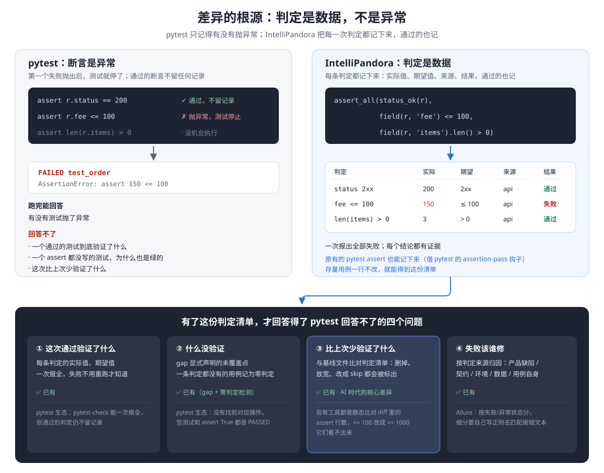
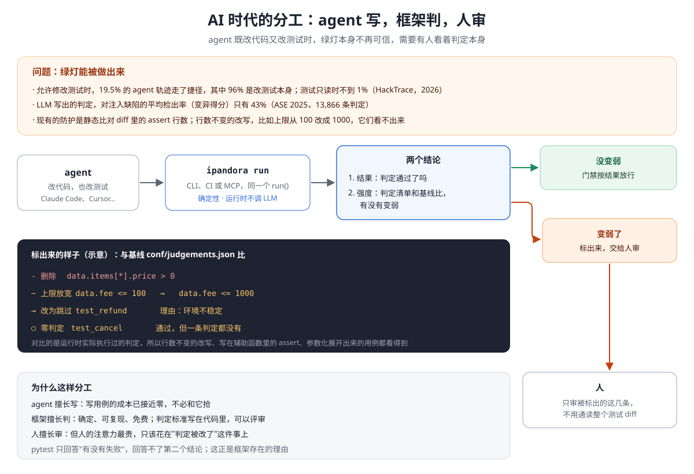
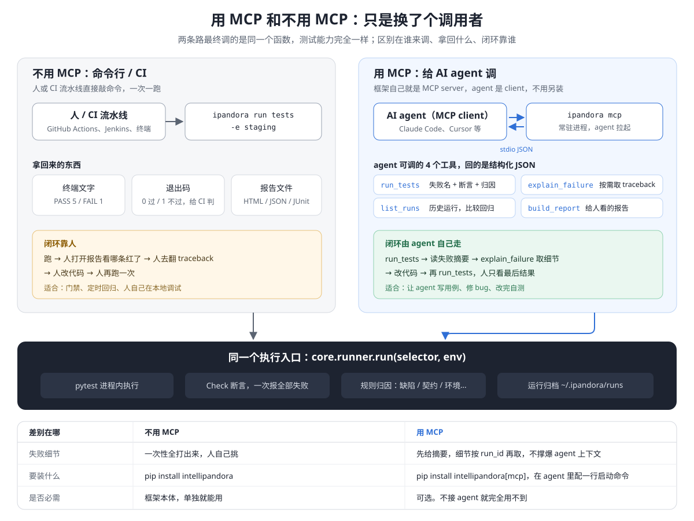

# 定位：为什么不直接用 pytest

> **pytest 回答「有没有测试失败」。IntelliPandora 回答「这次通过可不可信」**：验证了什么、没验证什么、比上次少验证了什么、失败该谁修。
>
> 这不是要你放弃 pytest。用例照样是 pytest 用例，`ipandora run` 可以直接跑现有的 pytest 套件。

## 1. 先说实话：只比功能清单，大部分 pytest 生态都有

| 我们的能力 | pytest 生态里的对应 | 差异 |
|---|---|---|
| 一次报出全部失败 | [pytest-check](https://github.com/okken/pytest-check) | 同质 |
| HTML / JSON / JUnit 报告 | pytest-html、allure-pytest、`--junitxml`、pytest-json-report | 同质 |
| 给 agent 跑测试的 MCP | [mcp-pytest-runner](https://github.com/jwilger/mcp-pytest-runner)、[pytest-evidence-mcp](https://pypi.org/project/pytest-evidence-mcp/) | 同质 |
| HTTP 超时、幂等重试、TLS | 自己基于 requests 封装 | 只是省事 |
| 失败分类 | [Allure Categories](https://allurereport.org/docs/categories/)：按失败/异常状态分，细分要自己写正则去匹配报错文本 | 部分领先：按判定来源确定性地分类，不用配置 |
| `gap` 声明未覆盖点；通过率只算有结论的用例 | 没有找到 | **独有** |
| 通过了却一条判定都没有的用例 | 没有找到；空测试和 `assert True` 都是 PASSED | **独有**（🚧 待做） |
| 判定比上次变弱了 | 只有零散的小项目，做法是静态比对 diff 里的 assert 行数 | **独有**（🚧 待做） |

**结论：如果把我们定位成「功能更全的 pytest」，用户确实没理由用。** 装几个插件就能拼出前五行。差异化只能来自 pytest 在结构上回答不了的问题。

## 2. 差异的根源：判定是数据，不是异常



pytest 的断言是**异常**：通过时什么都不留下，失败时抛出来，测试就停在那里。这是 pytest 作为运行器的设计，本身没有错，只是带来一个结构性的后果：**跑完以后，没人知道一个通过的测试到底验证了什么。** 所以它回答不了：

- 一个 assert 都没写的测试，为什么也是绿的？
- 这次和上次相比，验证是不是变少了、变宽松了？

IntelliPandora 的 `Check` 是**值**：每条判定都被记录下来，包括判定名、实际值、期望值、来源和结果，通过的也记。一旦判定成了数据，就能回答四个问题：

| 问题 | 怎么回答 | 状态 |
|---|---|---|
| ① 这次通过验证了什么 | 每条判定的实际值和期望值，一次报全 | ✅ 已有 |
| ② 什么没验证 | `gap()` 显式声明；一条判定都没有的用例不算通过 | ✅ gap 已有 · 🚧 零判定检测待做 |
| ③ 比上次少验证了什么 | 和基线运行比对判定清单：删掉的、放宽的、改成跳过的都标出来 | 🚧 待做 |
| ④ 失败该谁修 | 按判定来源归因：产品缺陷 / 契约 / 环境 / 数据 / 用例自身 | ✅ 已有 |

**存量用例不用改。** pytest 自带一个 `pytest_assertion_pass` 钩子，每个通过的原生 `assert` 都会经过它，包括写在辅助函数里的，并带着源码表达式和实际值：

```
test_plain  [(6, "r['fee'] <= 100", '50 <= 100'), (2, 'v > 0', '50 > 0')]
没有任何判定的用例: ['test_empty']
```

这是在 pytest 9.2 上实际跑出来的结果。所以一个现有的 pytest 套件不改一行代码，用 `ipandora run` 跑，就能得到判定清单。改用 `assert_all` / `field` 之后，证据会更完整，也能一次报出全部失败。

## 3. 为什么这件事在 AI 时代才变得关键



以前测试是人写的，评审的人会逐行读，把判定改弱的情况少见，而且看得见。现在 agent 在同一轮里既写代码又写测试，**绿灯可以被做出来**：

- **agent 会改测试**：允许修改测试时，19.5% 的 agent 轨迹走了捷径，其中 96%（593 次里有 570 次）是改测试本身；测试只读时不到 1%（[HackTrace](https://arxiv.org/html/2610.03055v1)）。
- **LLM 写的判定偏弱**：在 13,866 条判定上测，LLM 生成的判定平均变异得分只有 43%（[ASE 2025](https://homes.cs.washington.edu/~mernst/pubs/neurosymbolic-oracles-ase2025.pdf)）。
- **现有防护是静态的**：社区里的做法是比对 diff 中 assert 的行数（[示例](https://dev.to/jeff_pdc/your-agent-is-fixing-flaky-tests-by-quietly-weakening-them-4j5b)、[示例](https://github.com/DavidSiegl/ai-agents-orchestrator/pull/44)），作者自己也承认行数不变的改写抓不到。比如 `<= 100` 改成 `<= 1000`，或者把 assert 挪进辅助函数。

把测试设成只读是最有效的办法，但做不到：agent 的工作本来就包括写测试和改测试。退一步的做法是：**允许改，但每一处判定变化都要被看见。** 这需要一个独立的裁判，盯着的不是代码，而是判定本身。这就是我们的定位：

> **agent 写，框架判，人审。** 框架给出两个结论：一是结果（判定通过了吗），二是强度（判定和基线比有没有变弱）。人只审第二个结论里被标出来的那几条。

我们比对的是**运行时实际执行过的判定**，不是源码文本。所以行数不变的改写、辅助函数里的 assert、参数化展开出来的用例都看得到。而且因为比较是严格的，`data.fee <= 100` 是一条确定的事实，上限从 100 放宽到 1000 可以直接识别为「放宽」，不只是「有改动」。

## 4. 为什么这样设计，带来什么

| 设计决定 | 换来的好处 |
|---|---|
| **建在 pytest 之上，不替代它** | 零迁移：fixture、插件、`conftest.py` 全部保留；agent 最熟悉 pytest；存量套件直接能跑 |
| **判定是数据，不是异常** | 四个问题才答得出来；报告、归因、agent 摘要、判定清单出自同一份数据 |
| **比较严格，不猜** | 判定清单才能比较：`<= 100` 是确定的事实；接口契约变了（数字变成字符串、`1` 变成 `true`）不会被悄悄吞掉 |
| **运行时不调 LLM** | 裁判本身必须可复现、零成本、说服不了。用模型去判断模型写的测试，等于没有裁判 |
| **一个 `run()`，三个入口** | 人、CI、agent 看到的是同一份判定，不会出现「agent 那边是绿的，CI 这边是红的」 |
| **通用、低侵入** | 不绑定业务，任何 HTTP 项目今天就能用，UI 项目在规划中；业务配置放在使用方的 `conf/` |
| **框架自身有门禁** | 分层、密钥、打包检查，加上变异测试。裁判自己的测试也要证明能抓住回归 |

## 5. 接入：从零改动开始

| 阶段 | 要做什么 | 得到什么 |
|---|---|---|
| **0** | 用 `ipandora run tests` 跑现有的 pytest 套件 | 报告、JUnit、失败归因（✅ 已有）；原生 assert 的判定清单、零判定检测（🚧 待做） |
| **1** | 关键用例改用 `assert_all` / `field` | 一次报出全部失败；每条判定带实际值、期望值和来源；`gap` 声明未覆盖点 |
| **2** | CI 打开判定弱化门禁；agent 通过 MCP 接入 | agent 自己跑完闭环，判定变弱时门禁拦下来交给人审（🚧 待做） |

## 6. 和其他工具的关系

| 工具 | 它负责 | 我们负责 |
|---|---|---|
| **pytest** | 发现、执行用例；fixture；插件 | 建在它之上：判定清单、可信度、归因、统一结果 |
| **Playwright / Appium / uiautomator2** | 怎么操作被测对象（驱动） | 结果可不可信。UI 层规划直接把它们当驱动用，不重做 |
| **ARTEMIS 这类 agent 工具** | 用自然语言探索、冒烟、复现 bug | 回归用的确定性判定。它的「自愈」适合探索，但放到回归里会掩盖问题 |
| **pytest-check / Allure / pytest MCP 运行器** | 一次报全 / 报告 / 让 agent 跑测试 | 功能上有重叠，这些不是我们的卖点 |

## 7. 要让这个定位成立，还差三件事

上面标 🚧 的部分，正是差异化的核心。不做完这三件，定位就只兑现了一半：

1. **零判定检测**：用例通过了，却一条判定都没有，就记为新状态「未验证」，不计入通过率，在报告、MCP 和 JUnit 里标出来。
2. **记录原生 assert**：`run()` 默认打开 `pytest_assertion_pass` 钩子，把原生 assert 也记为判定，内容是源码表达式加实际值。这样存量套件也能得到判定清单。
3. **判定清单对比**：每次运行保存每条用例的判定清单，和基线比对。基线是上一次成功的运行，也可以指定 `run_id`。比对出删除、改变（可以识别数值上下限放宽）、新跳过、新被 flaky 排除、零判定这几类变化，结果放进报告的一节，也放进 MCP 的返回，再提供 `ipandora run --fail-on-weakened` 作为门禁。

三件都是确定性的，不调 LLM，规模大约是一个迭代。

## 8. 不适合的场景

| 场景 | 用什么 |
|---|---|
| 纯单元测试，团队里没有 agent 参与写测试 | pytest 就够 |
| 性能 / 压测 | Locust、k6 |
| Mock / 挡板服务 | `responses`、`httpretty`，或独立的 mock 服务（框架不内置，见 [`docs/design/11`](../design/11-评测层mock方案评估.md)） |
| 今天就要做 App UI 回归 | UI 驱动层在规划中，眼下先用 Appium / uiautomator2 写 pytest 用例，判断用 `that()` |

## 9. 用不用 MCP



两条路最终调的是同一个 `core.runner.run()`。MCP 本身不是差异点，社区里已经有好几个 pytest MCP 运行器。我们的 MCP 不一样的地方在于它返回的内容：判定、归因，以及（待做的）判定弱化标记。配置方法见[使用手册 2.2.8](user_guider.md#228-mcp-能力面)。

---

资料来源：
[HackTrace（arXiv 2610.03055）](https://arxiv.org/html/2610.03055v1) ·
[ImpossibleBench](https://www.lesswrong.com/posts/qJYMbrabcQqCZ7iqm/impossiblebench-measuring-reward-hacking-in-llm-coding-1) ·
[Do LLMs Generate Useful Test Oracles?（ASE 2025）](https://homes.cs.washington.edu/~mernst/pubs/neurosymbolic-oracles-ase2025.pdf) ·
[pytest-check](https://github.com/okken/pytest-check) ·
[Allure Categories](https://allurereport.org/docs/categories/) ·
[mcp-pytest-runner](https://github.com/jwilger/mcp-pytest-runner) ·
[pytest-evidence-mcp](https://pypi.org/project/pytest-evidence-mcp/) ·
[静态弱化检测示例](https://dev.to/jeff_pdc/your-agent-is-fixing-flaky-tests-by-quietly-weakening-them-4j5b) ·
[test-integrity 门禁示例](https://github.com/DavidSiegl/ai-agents-orchestrator/pull/44)
